# 问题一第 1 小问：数据质量评价最终报告

范围仅为数据质量评价。没有进行质量冲突消解、领域配比或其他问题。

## 数据规模、真实附件与清洗流程

官方 XZ 经 lzma 流式读取，22 维指标独立于 id/content/来源等辅助字段。
结构与类别顺序人工确认后，先标量化、按 A1 中位数填补、按 A1 阈值截尾，再统一方向构造 Z。
本阶段读取保存的 Z，不重新拟合预处理或 CRITIC；仅为 40 条核验文本回读原始 A1。

| dataset | source_file | n | source_unchanged |
|---|---|---|---|
| A1 | real_attachments/A_data_value/slimpajama_quality_signal_sample.jsonl.xz | 51230 | True |
| A2 | real_attachments/A_data_value/slimpajama_quality_extended/arxiv_part-6777d8857c6e-000486.jsonl.xz | 17523 | True |
| A3 | real_attachments/A_data_value/slimpajama_quality_extended/github_part-6777d8857c6e-000275.jsonl.xz | 203752 | True |

### 阶段 4B 输入文件与完整精度权重

| role | path | sha256_before | sha256_after | unchanged |
|---|---|---|---|---|
| feature_input | outputs/preprocess/A1_quality_features.csv | 27a2de665879a751e1362bedc923088841da07fa5deaa398c93f51b8f461ddbf | 27a2de665879a751e1362bedc923088841da07fa5deaa398c93f51b8f461ddbf | True |
| feature_input | outputs/preprocess/A2_arxiv_quality_features.csv | 8cc3649d590650f1bc927f1450c6e6e6f9e301ecdf4808c289d3642a534201ce | 8cc3649d590650f1bc927f1450c6e6e6f9e301ecdf4808c289d3642a534201ce | True |
| feature_input | outputs/preprocess/A3_github_quality_features.csv | 61e85463700488cb83640ae1aeb8e0b4314926459681acb278747ae401207a4a | 61e85463700488cb83640ae1aeb8e0b4314926459681acb278747ae401207a4a | True |
| locked_main_weight | outputs/quality/critic_weights_A1.csv | 70e01c89cfcd6b97a78e6e3c62db1055a52f217806b6f05dbe44fe0018b09b8f | 70e01c89cfcd6b97a78e6e3c62db1055a52f217806b6f05dbe44fe0018b09b8f | True |
| sensitivity_weight | outputs/quality/critic_weights_spearman_sensitivity.csv | a3105bfabdbf8b032ee222103322637831fb8e23d5b6ca3b4a67e33d00ce107d | a3105bfabdbf8b032ee222103322637831fb8e23d5b6ca3b4a67e33d00ce107d | True |
| locked_A1_model | outputs/preprocess/preprocessing_model_A1.json | 2464af4e2808107b98cff28d626c66d671ef42503f6521d85b8dfacf084a9b08 | 2464af4e2808107b98cff28d626c66d671ef42503f6521d85b8dfacf084a9b08 | True |
| selected_text_source | real_attachments/A_data_value/slimpajama_quality_signal_sample.jsonl.xz | 14a4eeec4c7d98efd78942ddd9c1329640527f2108e73227be449bc1a8dbe579 | 14a4eeec4c7d98efd78942ddd9c1329640527f2108e73227be449bc1a8dbe579 | True |

## 22 个指标处理与 A1 标定策略

全部填补值、分位数、qurater 四维范围、适中型阈值与连续 Min-Max 范围只由 A1 标定；A2/A3 共用固定模型。
旧 pooled profile 与 qurater_transform_parameters.csv 仅用于描述/敏感性，未删除、未作主模型参数。
原始 terminal_punctution 拼写通过 FIELD_ALIASES 映射到内部 terminal_punctuation，附件未改。

| metric | direction | scalarization | normalization |
|---|---|---|---|
| fineweb_edu | positive | single_value | A1 P01/P99 + Min-Max |
| dsir_books | positive | raw scalar | A1 P01/P99 + Min-Max |
| dsir_wiki | positive | raw scalar | A1 P01/P99 + Min-Max |
| dsir_math | positive | raw scalar | A1 P01/P99 + Min-Max |
| qurater | positive | component_winsor_minmax_mean | already bounded; no second Min-Max |
| modernbert_cleanliness | positive | argmax_scaled | already bounded; no second Min-Max |
| modernbert_readability | positive | argmax_scaled | already bounded; no second Min-Max |
| modernbert_reasoning | positive | argmax_scaled | already bounded; no second Min-Max |
| modernbert_professionalism | positive | argmax_scaled | already bounded; no second Min-Max |
| fluency_en | positive | argmax_index | already bounded; no second Min-Max |
| ad_en | positive | argmax_index | already bounded; no second Min-Max |
| rps_doc_word_count | moderate | raw scalar | A1 P01/P99 + trapezoid |
| rps_doc_num_sentences | moderate | raw scalar | A1 P01/P99 + trapezoid |
| rps_doc_unigram_entropy | positive | raw scalar | A1 P01/P99 + Min-Max |
| rps_doc_frac_unique_words | positive | raw scalar | A1 P01/P99 + Min-Max |
| rps_doc_frac_no_alph_words | negative | raw scalar | A1 P01/P99 + Min-Max |
| rps_doc_frac_chars_top_2gram | negative | raw scalar | A1 P01/P99 + Min-Max |
| rps_doc_frac_chars_top_3gram | negative | raw scalar | A1 P01/P99 + Min-Max |
| rps_lines_uppercase_letter_fraction | negative | raw scalar | A1 P01/P99 + Min-Max |
| rps_lines_ending_with_terminal_punctuation_mark | positive | raw scalar | A1 P01/P99 + Min-Max |
| rps_lines_numerical_chars_fraction | negative | raw scalar | A1 P01/P99 + Min-Max |
| rps_doc_mean_word_length | moderate | raw scalar | A1 P01/P99 + trapezoid |

fineweb 取唯一值；qurater 四语义维度独立 P01/P99 截尾、Min-Max 后平均，最终仍为一个指标；
modernbert 四项按等级 0…5 argmax/5，fluency 按 [not_fluent,fluent]、ad 按 [has_ad,no_ad] 取 argmax。
ad=1 表示无广告，为正向。主方案不使用 Softmax 期望。14 正向、5 负向、3 适中，严格 22 维。
适中梯形外端点为 P01/P99，满分平台 P10/P90；所有阈值保持 PHASE 3 已确认值。

## 缺失与重复记录

实际 19 个 scalar missing 涉及 19 条记录，每条仅缺 1 项。
19 项均采用 A1 同领域中位数，没有删除记录，没有触发总体回退；原始 NaN 向量不直接 argmax。
imputation_log.csv 可追溯填补 ID、指标、来源和填充值。

| dataset | domain | id | metric | imputed_value | imputation_method |
|---|---|---|---|---|---|
| A1 | commoncrawl | BkiUdKI4eILhQJnKqVYf | modernbert_professionalism | 0.4 | A1_domain_median |
| A1 | commoncrawl | BkiUeN3xK6wB9mpb3Bjn | modernbert_professionalism | 0.4 | A1_domain_median |
| A1 | commoncrawl | BkiUecLxK7IACwaaAoRW | modernbert_professionalism | 0.4 | A1_domain_median |
| A1 | commoncrawl | BkiUcp3xK6Ot9TMSqSKV | modernbert_professionalism | 0.4 | A1_domain_median |
| A1 | wikipedia | BkiUdSQ5qU2Ap3mnjRLV | modernbert_reasoning | 0.2 | A1_domain_median |
| A1 | wikipedia | BkiUcNvxK4tBVgEFUGsD | modernbert_reasoning | 0.2 | A1_domain_median |
| A1 | wikipedia | BkiUdnI5qWTD6lXPdKWn | modernbert_reasoning | 0.2 | A1_domain_median |
| A1 | wikipedia | BkiUd7I4eIXh4qTE6B0_ | modernbert_reasoning | 0.2 | A1_domain_median |
| A1 | wikipedia | BkiUco_xK7ICUuXekmA1 | modernbert_reasoning | 0.2 | A1_domain_median |
| A1 | wikipedia | BkiUe8jxK1yAga6JtoEE | modernbert_reasoning | 0.2 | A1_domain_median |
| A1 | wikipedia | BkiUdcU4ubnhBx1Jqx5c | modernbert_reasoning | 0.2 | A1_domain_median |
| A1 | wikipedia | BkiUbBg241xg-EsBtW7L | modernbert_reasoning | 0.2 | A1_domain_median |
| A1 | wikipedia | BkiUdIM5jDKDyKYv5QE8 | modernbert_reasoning | 0.2 | A1_domain_median |
| A1 | wikipedia | BkiUcCbxK1ThhCdy7RAd | modernbert_reasoning | 0.2 | A1_domain_median |
| A1 | wikipedia | BkiUeYzxK7IAHYL5-XVI | modernbert_professionalism | 0.4 | A1_domain_median |
| A1 | wikipedia | BkiUfZQ5qhDCd8S7ey87 | modernbert_reasoning | 0.2 | A1_domain_median |
| A1 | wikipedia | BkiUc9A5qhLA3caTagV_ | modernbert_reasoning | 0.2 | A1_domain_median |
| A1 | wikipedia | BkiUbO7xK6-gDz87OFCT | modernbert_reasoning | 0.2 | A1_domain_median |
| A3 | github | BkiUdg_xK3YB9m7_-uDT | modernbert_professionalism | 0.8 | A1_domain_median |
| scope | n | exact_duplicate_groups | duplicated_id_groups | SAME_ID_SAME_DATA_groups | SAME_ID_DIFFERENT_DATA_groups |
|---|---|---|---|---|---|
| A1 | 51230 | 0 | 0 | 0 | 0 |
| A2 | 17523 | 0 | 0 | 0 | 0 |
| A3 | 203752 | 0 | 0 | 0 | 0 |
| A1+A2+A3 | 272505 | 0 | 11419 | 11419 | 0 |

跨附件同 ID 记录保留。A3 不同 ID 但原 22 质量字段相同的那组两条记录也保留，
缺 content 不能证明文本重复。完整 exact duplicate 与质量字段一致的口径不同。

| comparison | same_id | same_id_same_quality_pairs | same_id_different_quality_pairs | content_not_comparable_pairs |
|---|---|---|---|---|
| A1-arxiv vs A2-arxiv | 1419 | 1419 | 0 | 1419 |
| A1-github vs A3-github | 10000 | 10000 | 0 | 10000 |

## CRITIC 主权重与稳定性

只用 A1：σ_j=std(Z_j,ddof=1)，r_jk=Pearson(Z_j,Z_k)，R_j=Σ_k(1−r_jk)，C_j=σ_jR_j，w_j=C_j/ΣC_j。
负相关保留，不取绝对值、不人工修正。读取 critic_weights_A1.csv 完整浮点精度，未用展示时四舍五入权重。

| metric | critic_weight | weight_rank |
|---|---|---|
| fluency_en | 0.08178702498722983 | 1 |
| modernbert_professionalism | 0.06980206308955562 | 2 |
| rps_lines_ending_with_terminal_punctuation_mark | 0.06176704477048421 | 3 |
| rps_lines_uppercase_letter_fraction | 0.060142722656858716 | 4 |
| modernbert_reasoning | 0.05583384227150351 | 5 |
| ad_en | 0.05335404431817679 | 6 |
| modernbert_readability | 0.04942509970962934 | 7 |
| modernbert_cleanliness | 0.047343371969521104 | 8 |
| rps_doc_frac_unique_words | 0.04689812908466757 | 9 |
| rps_doc_mean_word_length | 0.045756651535417615 | 10 |
| rps_doc_word_count | 0.04249121186394873 | 11 |
| rps_doc_num_sentences | 0.04129701597841696 | 12 |
| rps_doc_unigram_entropy | 0.04103596535582756 | 13 |
| fineweb_edu | 0.03974907022918245 | 14 |
| rps_lines_numerical_chars_fraction | 0.03790519065739816 | 15 |
| rps_doc_frac_chars_top_2gram | 0.03712406048691399 | 16 |
| rps_doc_frac_chars_top_3gram | 0.03709563320380188 | 17 |
| rps_doc_frac_no_alph_words | 0.03406524613775351 | 18 |
| qurater | 0.0318464208770474 | 19 |
| dsir_math | 0.028943288950307882 | 20 |
| dsir_books | 0.02846927381294921 | 21 |
| dsir_wiki | 0.02786762805340801 | 22 |

权重和=1.0；H_norm=0.986358405；
前五权重累计=32.933270%。无高于 0.10、低于 0.01 权重及常数退化指标。
Pearson 与 Spearman 权重相关=0.990722432，权重秩相关=0.983060418。

## 样本级 Q 与数据集描述统计

Q_i=Σ_{j=1}^{22}w_jz_ij。A1/A2/A3 使用同一组 A1 Pearson-CRITIC 权重。
因为 z∈[0,1]、w≥0、Σw=1，Q∈[0,1]；实际写出文件逐项验证有限性和范围。主 CSV 不包含 content。

| dataset | n | mean_Q | std_Q | min_Q | P01 | P05 | P10 | P25 | median_Q | P75 | P90 | P95 | P99 | max_Q |
|---|---|---|---|---|---|---|---|---|---|---|---|---|---|---|
| A1 | 51230 | 0.7161820768808068 | 0.08589948840065663 | 0.30649962546558407 | 0.48428871111065913 | 0.5570873038385765 | 0.5964468533274349 | 0.6627858812104124 | 0.7301786313275413 | 0.7770629082139558 | 0.8148512290149375 | 0.8376664673764941 | 0.8792255055720026 | 0.9511217995313428 |
| A2 | 17523 | 0.7592235011593877 | 0.05485039419674888 | 0.4056710794910673 | 0.643371500299241 | 0.6736283491207872 | 0.6862136605582396 | 0.7152449224500425 | 0.7631079929271833 | 0.8038876768926225 | 0.8288439754857412 | 0.8400028761052998 | 0.8585030012648927 | 0.8991626285897524 |
| A3 | 203752 | 0.6443952910501758 | 0.07941261376469548 | 0.3029539080974663 | 0.4513283385849857 | 0.501284255166063 | 0.5341060513875708 | 0.5906033540493248 | 0.6519363505354446 | 0.7043320418245167 | 0.7400802551957053 | 0.7604919713154068 | 0.7990419661946166 | 0.8781779941794334 |
| dataset | n | min_Q | max_Q | nan_count | inf_count | all_in_0_1 |
|---|---|---|---|---|---|---|
| A1 | 51230 | 0.30649962546558407 | 0.9511217995313428 | 0 | 0 | True |
| A2 | 17523 | 0.4056710794910673 | 0.8991626285897524 | 0 | 0 | True |
| A3 | 203752 | 0.3029539080974663 | 0.8781779941794334 | 0 | 0 | True |

## A1 主领域质量与 Bootstrap

Q_domain=TrimmedMean_10%(Q_i)，每侧截去 floor(0.10n) 个值，剩余约 80% 求均值。
95% CI 针对同一个 trimmed mean：固定根种子 2026、每组 2000 次普通完整 n-out-of-n 重采样，
每次实际抽取 n 个值并精确截尾，以 bootstrap 分布的 2.5%/97.5% 分位点得到区间。
没有对大扩展集缩减样本量或用正态/有效样本数近似。各组由固定顺序 SeedSequence 子流生成；
bootstrap_trimmed_means.csv 保存全部复制统计量，置信区间反映所用抽样/重采样假设而非因果可靠性。

| domain | n | mean_Q | median_Q | std_Q | P10 | P25 | P75 | P90 | Q_domain | ci95_low | ci95_high | quality_rank |
|---|---|---|---|---|---|---|---|---|---|---|---|---|
| arxiv | 1419 | 0.7633561986194862 | 0.7709504559597999 | 0.05404700684273518 | 0.6883182480857353 | 0.7205829486695685 | 0.8066544560831863 | 0.8295177530923147 | 0.7651065297732803 | 0.7620560216777708 | 0.768048662293355 | 1 |
| c4 | 10000 | 0.7579509355953442 | 0.7699226681413945 | 0.07757771678362801 | 0.6537276181576358 | 0.718666021140562 | 0.8087439029267468 | 0.8441918978828484 | 0.7639452843183598 | 0.7624402738433214 | 0.7653826493999661 | 2 |
| commoncrawl | 9640 | 0.7538416581493723 | 0.7624478307110831 | 0.07164306740275712 | 0.6562805941598084 | 0.7213657473965329 | 0.8001612215496754 | 0.8358543432340777 | 0.7597307676184978 | 0.7583716054623645 | 0.7611497551065062 | 3 |
| stackexchange | 10000 | 0.7431803667986894 | 0.7536057577223023 | 0.05769750292283178 | 0.6606634788462509 | 0.7134797454755698 | 0.7806370409000805 | 0.8063395301914759 | 0.7475281055884827 | 0.7463503501562435 | 0.7486483368189486 | 4 |
| wikipedia | 10000 | 0.6775495710264972 | 0.6851936107161809 | 0.07620578508516307 | 0.5803901927027129 | 0.6282918995079467 | 0.7334013675832111 | 0.7655536699961523 | 0.6812641222241059 | 0.6797753120437969 | 0.6827504490397043 | 5 |
| github | 10000 | 0.645306201299506 | 0.6536065029701426 | 0.0789222938506082 | 0.5341648045541595 | 0.5908045848113792 | 0.7055673706426522 | 0.7392791016621167 | 0.6489286992466243 | 0.6472522554478902 | 0.6506059467699508 | 6 |
| book | 171 | 0.5842164970898797 | 0.5884399257023907 | 0.07171077156401137 | 0.490191491552562 | 0.5407610412141706 | 0.639329374489344 | 0.6678987661072594 | 0.5867366961905537 | 0.5755362378865475 | 0.5975001064093607 | 7 |

相邻排名中置信区间重叠的领域：arxiv/c4。点估计排序不能直接解释为前者显著优于后者，CI重叠也不等同于正式差值检验。

## 扩展全量与非重叠余集领域质量

| dataset | domain | view | n | mean_Q | median_Q | std_Q | trimmed_mean_Q | ci95_low | ci95_high |
|---|---|---|---|---|---|---|---|---|---|
| A2 | arxiv | full | 17523 | 0.7592235011593877 | 0.7631079929271833 | 0.05485039419674888 | 0.7604773029995668 | 0.7596021954977891 | 0.761432562129063 |
| A3 | github | full | 203752 | 0.6443952910501758 | 0.6519363505354446 | 0.07941261376469548 | 0.6478468093691868 | 0.6474971536557205 | 0.6482081518467347 |
| A2 | arxiv | nonoverlap | 16104 | 0.7588593495389282 | 0.7623022326176969 | 0.05490736619782873 | 0.7600673210546035 | 0.759095224552103 | 0.7610196016253449 |
| A3 | github | nonoverlap | 193752 | 0.644348276812938 | 0.6518207825567239 | 0.07943775721478619 | 0.6477910313710004 | 0.6473980526003347 | 0.6481487603017394 |

非重叠索引只选择 A2 IDs−A1-arxiv IDs、A3 IDs−A1-github IDs，不删除全量质量输出，也不复制完整 Z。

## 抽样—扩展一致性与效应量

所有有符号差值为扩展减 A1 抽样；relative_difference 是 trimmed mean 差除以抽样 trimmed mean 的绝对值。
Cliff's delta=P(Q_extended>Q_sample)−P(Q_extended<Q_sample)，并列贡献为零；正值表示扩展倾向更高。
Wasserstein 距离使用 Q 原尺度，KS 衡量最大 CDF 差。不能只用 p-value 宣称分布完全相同/不同。
full 扩展包含 A1 记录，两组不独立；其 KS p-value 仅作描述性参考，不能作为独立双样本推断。
nonoverlap 消除共享记录，但未知的抽样设计与潜在来源相关性仍限制 iid 推断。

| comparison | view | sample_n | extended_n | mean_difference | median_difference | trimmed_mean_difference | relative_difference | KS_statistic | KS_p_value | Wasserstein_distance | Cliffs_delta | shared_id_count |
|---|---|---|---|---|---|---|---|---|---|---|---|---|
| A1-arxiv vs A2-full | full | 1419 | 17523 | -0.004132697460098478 | -0.007842463032616598 | -0.0046292267737134685 | -0.00605043427754462 | 0.046542152572897566 | 0.006551609140450774 | 0.004149090030672472 | -0.043103160863340505 | 1419 |
| A1-arxiv vs A2-nonoverlap | nonoverlap | 1419 | 16104 | -0.00449684908055803 | -0.008648223342103023 | -0.005039208718676802 | -0.006586283769098197 | 0.05064320290206675 | 0.0024003476292029746 | 0.004514686078457136 | -0.04690118528367584 | 0 |
| A1-github vs A3-full | full | 10000 | 203752 | -0.0009109102493302101 | -0.0016701524346979246 | -0.001081889877437514 | -0.0016671937590270508 | 0.011258914759118888 | 0.17698721244647986 | 0.0012448110660420312 | -0.007790455063017786 | 10000 |
| A1-github vs A3-nonoverlap | nonoverlap | 10000 | 193752 | -0.0009579244865679515 | -0.0017857204134186233 | -0.001137667875623971 | -0.0017531477293957717 | 0.011840014038564717 | 0.13791038670738387 | 0.0013090587159265245 | -0.008192538915727321 | 0 |

- A1-arxiv vs A2-full：trimmed mean 差 -0.00462923（相对 -0.6050%），
  KS=0.046542，Wasserstein=0.004149，Cliff's delta=-0.043103。
  这些量分别描述位置、CDF 形态和成对排序；差异必须结合 Q 的模型含义解释，不能据显著性自动判定实质质量差异。

- A1-arxiv vs A2-nonoverlap：trimmed mean 差 -0.00503921（相对 -0.6586%），
  KS=0.050643，Wasserstein=0.004515，Cliff's delta=-0.046901。
  这些量分别描述位置、CDF 形态和成对排序；差异必须结合 Q 的模型含义解释，不能据显著性自动判定实质质量差异。

- A1-github vs A3-full：trimmed mean 差 -0.00108189（相对 -0.1667%），
  KS=0.011259，Wasserstein=0.001245，Cliff's delta=-0.007790。
  这些量分别描述位置、CDF 形态和成对排序；差异必须结合 Q 的模型含义解释，不能据显著性自动判定实质质量差异。

- A1-github vs A3-nonoverlap：trimmed mean 差 -0.00113767（相对 -0.1753%），
  KS=0.011840，Wasserstein=0.001309，Cliff's delta=-0.008193。
  这些量分别描述位置、CDF 形态和成对排序；差异必须结合 Q 的模型含义解释，不能据显著性自动判定实质质量差异。

## 等权与 Spearman-CRITIC 敏感性

Q_equal=mean(Z_i)；Q_spearman 使用 PHASE 4A 已保存的 Spearman 权重，仅为敏感性，均不替代主模型。
领域排名都依据各方案的 10% trimmed mean，而不是混用平均数排名。rank_change=敏感性排名−主排名。

| scope | alternative | domain | n | pearson_correlation | spearman_correlation | main_Q_domain | alternative_Q_domain | main_rank | alternative_rank | rank_change |
|---|---|---|---|---|---|---|---|---|---|---|
| overall | equal | ALL | 51230 | 0.9793108458049755 | 0.9821043579510323 |  |  |  |  |  |
| domain | equal | arxiv | 1419 | 0.9911398796135966 | 0.9934755465764527 | 0.7651065297732803 | 0.7396484270151045 | 1 | 4 | 3 |
| domain | equal | c4 | 10000 | 0.9912890794554944 | 0.9939085667310856 | 0.7639452843183598 | 0.7768329058920146 | 2 | 1 | -1 |
| domain | equal | commoncrawl | 9640 | 0.983708273543785 | 0.9871399956151495 | 0.7597307676184978 | 0.7767417940068666 | 3 | 2 | -1 |
| domain | equal | stackexchange | 10000 | 0.9757297545667624 | 0.9836934611849346 | 0.7475281055884827 | 0.7597573328950077 | 4 | 3 | -1 |
| domain | equal | wikipedia | 10000 | 0.9808502703439157 | 0.9819412399114125 | 0.6812641222241059 | 0.7110558788979142 | 5 | 5 | 0 |
| domain | equal | github | 10000 | 0.9678258712084333 | 0.9675293167232932 | 0.6489286992466243 | 0.6723013907462252 | 6 | 6 | 0 |
| domain | equal | book | 171 | 0.9499344589360579 | 0.9487412100703195 | 0.5867366961905537 | 0.5686642481716698 | 7 | 7 | 0 |
| overall | spearman_critic | ALL | 51230 | 0.9996337473751594 | 0.9996834210280957 |  |  |  |  |  |
| domain | spearman_critic | arxiv | 1419 | 0.9997537392610217 | 0.9997679706221837 | 0.7651065297732803 | 0.7663241363521677 | 1 | 1 | 0 |
| domain | spearman_critic | c4 | 10000 | 0.9998314217688307 | 0.9997787913977879 | 0.7639452843183598 | 0.7646632476082791 | 2 | 2 | 0 |
| domain | spearman_critic | commoncrawl | 9640 | 0.9998424830175598 | 0.9998130984700327 | 0.7597307676184978 | 0.762934656695222 | 3 | 3 | 0 |
| domain | spearman_critic | stackexchange | 10000 | 0.9996261054875325 | 0.9995784481077845 | 0.7475281055884827 | 0.7509527624287653 | 4 | 4 | 0 |
| domain | spearman_critic | wikipedia | 10000 | 0.9994470333201273 | 0.9995056718510568 | 0.6812641222241059 | 0.6839913386598988 | 5 | 5 | 0 |
| domain | spearman_critic | github | 10000 | 0.9994620092138956 | 0.9995258620912586 | 0.6489286992466243 | 0.6522296027291868 | 6 | 6 | 0 |
| domain | spearman_critic | book | 171 | 0.999589523333655 | 0.9995752033983729 | 0.5867366961905537 | 0.5837743165573852 | 7 | 7 | 0 |

等权有 4 个领域发生排名变化：arxiv 1→4, c4 2→1, commoncrawl 3→2, stackexchange 4→3。样本评分相关性高不能自动推出领域排名完全稳定。

Spearman-CRITIC有 0 个领域发生排名变化：无。样本评分相关性高不能自动推出领域排名完全稳定。

## 高低 Q 文本核验

仅 A1 有 content。按 Q 排序选最高和最低各 20 条，遇相同 Q 用 ID 字典序稳定排序，
再依据 id 和来源行号回读原件；只保存这 40 条文本到 top20/bottom20 CSV。content 没有进入评分。

以下为助手逐条阅读后的文本复核记录，不冒称独立人工确认。判读使用材料中注明的阅读范围；
完整 content 已导出供人工复核，文体/领域差异也会影响指标，应避免把代码天然判为低质。

| set | rank | id | domain | Q | review_scope | observations | judgement | limitations |
|---|---|---|---|---|---|---|---|---|
| top20 | 1 | BkiUd57xK6nrxqmo0H2_ | c4 | 0.9511217995313428 | full_text | 有限元课程说明，术语、学习目标和章节范围清晰，英文段落连贯。 | 高分方向基本支持 | 助手非盲评，未独立核实事实或取得人工确认 |
| top20 | 2 | BkiUd27xK0iCl7DT8mqj | c4 | 0.9459499736741437 | full_text | 细菌群体感应及酶降解机制介绍，有问题背景、机制和研究结论。 | 高分方向基本支持 | 助手非盲评，未独立核实事实或取得人工确认 |
| top20 | 3 | BkiUdEk4eILhQJztm_1T | c4 | 0.9448834599721827 | full_text | 应激颗粒和蛋白相分离研究简介，主题集中，专业词汇和研究目的明确。 | 高分方向基本支持 | 助手非盲评，未独立核实事实或取得人工确认 |
| top20 | 4 | BkiUdos5i7PA9OlIEsAR | c4 | 0.9443034820179974 | full_text | 耐药细菌与酶抑制研究背景、策略和团队介绍连贯；有少量词间空格粘连。 | 高分方向基本支持 | 助手非盲评，未独立核实事实或取得人工确认 |
| top20 | 5 | BkiUdZDxK7kjXIdG-ymo | c4 | 0.9439617747621853 | full_text | 光子压缩科普正文之后混入两条读者评论；评论含未外部核实的宇宙理论断言，正文与评论没有质量隔离。 | 高分但含混合内容 | 助手非盲评，未独立核实事实或取得人工确认 |
| top20 | 6 | BkiUdj44eIZijkbdOFqN | c4 | 0.9355403279511603 | full_text | 多门哲学课程目录，说明对象、主题和先修要求，段落可读；是课程集合而非单篇论证。 | 高分方向基本支持 | 助手非盲评，未独立核实事实或取得人工确认 |
| top20 | 7 | BkiUdfE5jDKDyIlaY3YG | c4 | 0.9349506056620236 | full_text | 神经影像研究主题与征稿说明，列出方法和研究范围，专业且连贯。 | 高分方向基本支持 | 助手非盲评，未独立核实事实或取得人工确认 |
| top20 | 8 | BkiUdNo4uzlh5XI9nkO- | c4 | 0.9337808228290378 | full_text | 豆类食品政策项目介绍，包含背景、参与者、研究程序和政策路径，细节较丰富。 | 高分方向基本支持 | 助手非盲评，未独立核实事实或取得人工确认 |
| top20 | 9 | BkiUgB3xK6nrxjHzERm9 | c4 | 0.9314245872914495 | full_text | 城市绅士化与住房政策综述，列出研究结果、限定性措辞及政策建议；末尾含另一篇文章标题。 | 高分方向基本支持 | 助手非盲评，未独立核实事实或取得人工确认 |
| top20 | 10 | BkiUdhg4ubnhDOg0XEbT | c4 | 0.9310706779034112 | full_text | 马蹄病主题长文，分辨病因、症状和处置观点，专业术语丰富且叙述连贯。 | 高分方向基本支持 | 助手非盲评，未独立核实事实或取得人工确认 |
| top20 | 11 | BkiUa785jDKDyDz_63p4 | c4 | 0.9295586111504024 | full_text | 空中交通显示实验摘要，描述问题、两组实验和结果，结构紧凑完整。 | 高分方向基本支持 | 助手非盲评，未独立核实事实或取得人工确认 |
| top20 | 12 | BkiUczY4dbggz-0vzZOy | c4 | 0.928977196857764 | full_text | 全球安全方向课程及学习目标清晰，但结尾有职业路径、学位项目招生推广；高分不等于完全无推广。 | 高分但含混合内容 | 助手非盲评，未独立核实事实或取得人工确认 |
| top20 | 13 | BkiUd245qoTA9Gqu23Bt | c4 | 0.9279610828439229 | full_text | 政治党派权力分析理论框架简介，概念与研究计划清晰；含会议及出版宣传。 | 高分方向基本支持 | 助手非盲评，未独立核实事实或取得人工确认 |
| top20 | 14 | BkiUa_04ukPiEKkD6Qcp | c4 | 0.9276220039080241 | full_text | 北海盆地断层与伸展构造摘要，地域、机制及解释具体，主题集中。 | 高分方向基本支持 | 助手非盲评，未独立核实事实或取得人工确认 |
| top20 | 15 | BkiUabLxK6nrxl9bK0SW | c4 | 0.9268395661869109 | full_text | 人身保护令法律评论主体可读，末尾混入读者评论，存在未经评分隔离的正文与评论。 | 高分但含混合内容 | 助手非盲评，未独立核实事实或取得人工确认 |
| top20 | 16 | BkiUeeHxK0iCl4YJoSVs | c4 | 0.9268142505460706 | full_text | 中亚精英主导抗议研究的书籍简介，论点、比较对象和访谈方法清楚。 | 高分方向基本支持 | 助手非盲评，未独立核实事实或取得人工确认 |
| top20 | 17 | BkiUfAzxK7kjXMEc-1iC | c4 | 0.9265029774036011 | full_text | 四元数姿态技术说明，解释万向锁、坐标系和转换注意事项；含传感器产品名称但有实质技术内容。 | 高分方向基本支持 | 助手非盲评，未独立核实事实或取得人工确认 |
| top20 | 18 | BkiUdZfxK6wB9lIs9F_L | c4 | 0.9261055771411428 | full_text | AI专利技术贡献的历史评论，引用案例和观点，论述连贯；不把时效与法律正确性当作已验证。 | 高分方向基本支持 | 助手非盲评，未独立核实事实或取得人工确认 |
| top20 | 19 | BkiUd87xK7IDPV_Itr5v | c4 | 0.9258073200437313 | full_text | 聚合物纳米颗粒与活性污泥研究，含问题、实验方法及结论；文字依赖图1–3，图像不在本纯文本中。 | 高分方向基本支持 | 助手非盲评，未独立核实事实或取得人工确认 |
| top20 | 20 | BkiUcL3xK0fkXPSOpNM4 | c4 | 0.9254313102931231 | full_text | 大学新闻页面拼接民粹主义、社会活动、财富研究和哲学等多篇主题；各段流畅但不是单一主题文章。 | 高分但含混合内容 | 助手非盲评，未独立核实事实或取得人工确认 |
| bottom20 | 1 | BkiUd-Q4eIOjR5O2q-xu | wikipedia | 0.30649962546558407 | head_middle_tail_only | 大量小行星发现记录的维基表格，数值、日期及模板重复；缺少连续叙述，但不因此认定天文表格无用。 | 低分主要反映结构化文体 | 助手非盲评，未独立核实事实或取得人工确认；长文本仅抽查头中尾，未逐字核验全部内容 |
| bottom20 | 2 | BkiUdKc5qoYDgZr1C7qj | wikipedia | 0.3263234630191862 | full_text | 两条同名城市消歧条目，非英语、极短；列表作用明确，不是明显乱码。 | 低分主要反映短非英语文体 | 助手非盲评，未独立核实事实或取得人工确认；英语评级及长度效用可能不适合多语言消歧页 |
| bottom20 | 3 | BkiUatnxaJJQnKM6ru-R | commoncrawl | 0.3310304820363281 | head_middle_tail_only | 羊绒产品营销文案混有大量价格、规格、SKU及schema产品片段；抽取噪声和模板重复明显。 | 低分抓取噪声较多 | 助手非盲评，未独立核实事实或取得人工确认；长文本仅抽查头中尾，未逐字核验全部内容 |
| bottom20 | 4 | BkiUawzxK1yAgWt78Dn2 | wikipedia | 0.332619804751846 | full_text | 两条同名乡村行政区消歧条目，非英语且短，内容有明确列表功能。 | 低分主要反映短非英语文体 | 助手非盲评，未独立核实事实或取得人工确认；英语评级及长度效用可能不适合多语言消歧页 |
| bottom20 | 5 | BkiUbOs4eIXguuEPj4P7 | wikipedia | 0.3376199259837359 | full_text | 歌曲标题的四条非英语消歧列表，保留年份和艺人；短列表不等于低事实价值。 | 低分主要反映短非英语文体 | 助手非盲评，未独立核实事实或取得人工确认；英语评级及长度效用可能不适合多语言消歧页 |
| bottom20 | 6 | BkiUcMHxK7ICUubsyxZ- | wikipedia | 0.3378086705521851 | full_text | 两条同名村落消歧条目，非英语且短；没有长段落，但无明显广告。 | 低分主要反映短非英语文体 | 助手非盲评，未独立核实事实或取得人工确认；英语评级及长度效用可能不适合多语言消歧页 |
| bottom20 | 7 | BkiUdFc25V5ipNhMBvq9 | wikipedia | 0.33852188448997766 | full_text | 意大利语专辑与单曲两条消歧信息，短且结构正常。 | 低分主要反映短非英语文体 | 助手非盲评，未独立核实事实或取得人工确认；英语评级及长度效用可能不适合多语言消歧页 |
| bottom20 | 8 | BkiUdzDxK5YsWR0KjsCt | commoncrawl | 0.3391319075360882 | head_middle_tail_only | 主要为网站URL、90% Daily和日期时间的长目录，模板重复，缺少正文论述。 | 低分抓取噪声较多 | 助手非盲评，未独立核实事实或取得人工确认；长文本仅抽查头中尾，未逐字核验全部内容 |
| bottom20 | 9 | BkiUfIc25V5jJ1pbcBbQ | wikipedia | 0.34112771813155135 | full_text | 两条地方委员会消歧条目，非英语且短，表达具有行政区索引意义。 | 低分主要反映短非英语文体 | 助手非盲评，未独立核实事实或取得人工确认；英语评级及长度效用可能不适合多语言消歧页 |
| bottom20 | 10 | BkiUfo3xK7IDA31U2AAQ | wikipedia | 0.3500742408234255 | full_text | 两条同名村落列表，非英语且短，地理指向明确。 | 低分主要反映短非英语文体 | 助手非盲评，未独立核实事实或取得人工确认；英语评级及长度效用可能不适合多语言消歧页 |
| bottom20 | 11 | BkiUbEw5qsFAfyH9wbYA | wikipedia | 0.3536451422388785 | full_text | 两条同名乡村行政区列表，非英语且短，条目结构正常。 | 低分主要反映短非英语文体 | 助手非盲评，未独立核实事实或取得人工确认；英语评级及长度效用可能不适合多语言消歧页 |
| bottom20 | 12 | BkiUdpvxK0-nUh8iJ2mI | wikipedia | 0.3609978624599981 | full_text | 三个同名地理对象的消歧列表，非英语且短，列表有组织而非随机重复。 | 低分主要反映短非英语文体 | 助手非盲评，未独立核实事实或取得人工确认；英语评级及长度效用可能不适合多语言消歧页 |
| bottom20 | 13 | BkiUfirxK3YB9ohkPTLZ | wikipedia | 0.36692428340088357 | full_text | 数字1399与公元前后年份的三条消歧，非英语且极短，功能明确。 | 低分主要反映短非英语文体 | 助手非盲评，未独立核实事实或取得人工确认；英语评级及长度效用可能不适合多语言消歧页 |
| bottom20 | 14 | BkiUdCA5qhDBRmv5tkMt | commoncrawl | 0.36928266928258324 | head_middle_tail_only | 音乐人网站地区目录，姓名、地点、邮编模板贯穿头中尾，页面很长且结尾截断；未展示连续文章。 | 低分抓取噪声较多 | 助手非盲评，未独立核实事实或取得人工确认；长文本仅抽查头中尾，未逐字核验全部内容 |
| bottom20 | 15 | BkiUc2E4uzlhbeH0ZXJS | wikipedia | 0.3701112892049431 | full_text | 波兰语飞机名称与专辑名称的两条消歧，短且可解释。 | 低分主要反映短非英语文体 | 助手非盲评，未独立核实事实或取得人工确认；英语评级及长度效用可能不适合多语言消歧页 |
| bottom20 | 16 | BkiUboM5qoaAwnMw8DN9 | wikipedia | 0.3751254416512636 | full_text | 同名行政区在两国的消歧，非英语短列表，层次结构正常。 | 低分主要反映短非英语文体 | 助手非盲评，未独立核实事实或取得人工确认；英语评级及长度效用可能不适合多语言消歧页 |
| bottom20 | 17 | BkiUffnxK7FjYEB4Xn7q | wikipedia | 0.37820260052954774 | full_text | 德语排球赛事男女组消歧列表，短但表达连贯，不是广告或乱码。 | 低分主要反映短非英语文体 | 助手非盲评，未独立核实事实或取得人工确认；英语评级及长度效用可能不适合多语言消歧页 |
| bottom20 | 18 | BkiUdtc5qWTBDpT5Q_l9 | wikipedia | 0.37841914149501055 | full_text | 两条行政区消歧信息，非英语且短，有明确地理限定。 | 低分主要反映短非英语文体 | 助手非盲评，未独立核实事实或取得人工确认；英语评级及长度效用可能不适合多语言消歧页 |
| bottom20 | 19 | BkiUgB_xK7kjXMEc_2sI | github | 0.3784477309369867 | head_middle_tail_only | 游戏角色XML配置，重复state/case标签较多；全文件XML解析成功，低自然语言评分不能证明配置损坏。 XML根节点=opponent，实际节点数=972。 | 低分主要反映结构化文体 | 助手非盲评，未独立核实事实或取得人工确认；长文本仅抽查头中尾，未逐字核验全部内容 |
| bottom20 | 20 | BkiUeHY5qoTBG9o643V5 | github | 0.3811205593763753 | head_middle_tail_only | 自动生成的Protobuf C#服务代码，包含描述符和序列化模板；自然语言连贯度低不等于代码无效。 | 低分主要反映结构化文体 | 助手非盲评，未独立核实事实或取得人工确认；长文本仅抽查头中尾，未逐字核验全部内容；未编译或运行代码 |

top20 助手复核分布：{"高分方向基本支持": 16, "高分但含混合内容": 4}。

top20 来源领域：{"c4": 20}。

bottom20 助手复核分布：{"低分主要反映结构化文体": 3, "低分主要反映短非英语文体": 14, "低分抓取噪声较多": 3}。

bottom20 来源领域：{"wikipedia": 15, "commoncrawl": 3, "github": 2}。

所见高分端多为专业、连贯英文，但部分正文混入评论/推广/跨主题拼接；低分端也包含功能正常的短多语言消歧页、天文表格和结构化代码。
XML样本全文件解析成功，代码样本未编译；因此低Q主要反映本指标体系对文体/语言的适配程度，不能统一当作事实错误或内容无用。
本次核验提供支持及反例，未反向修正已锁定的预处理或权重。

## 图表

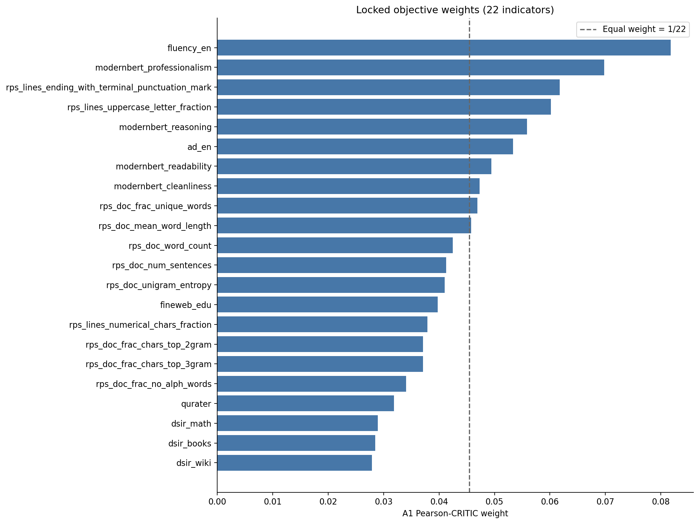

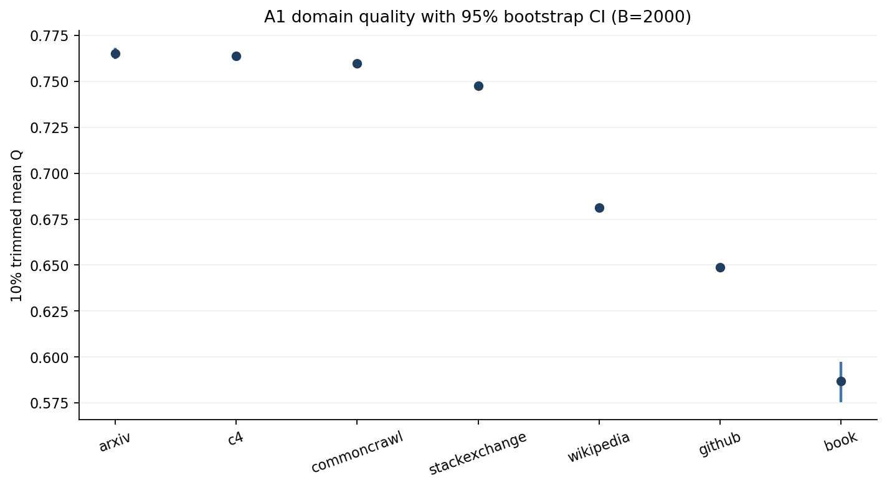

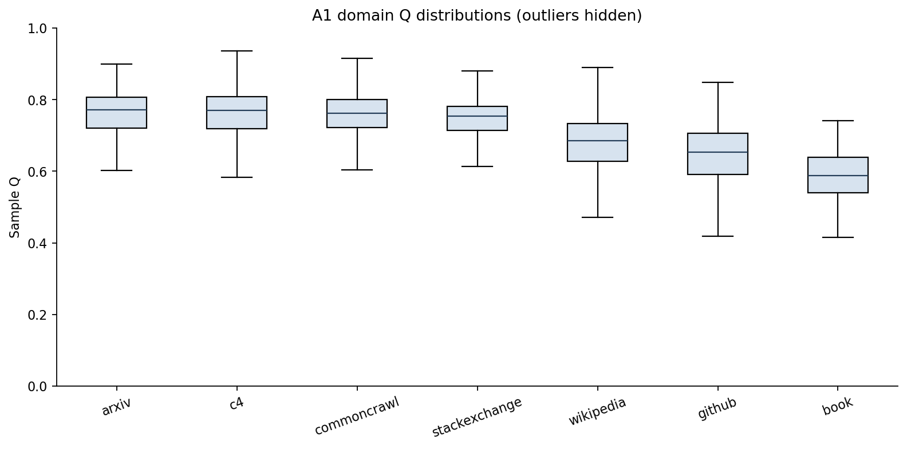

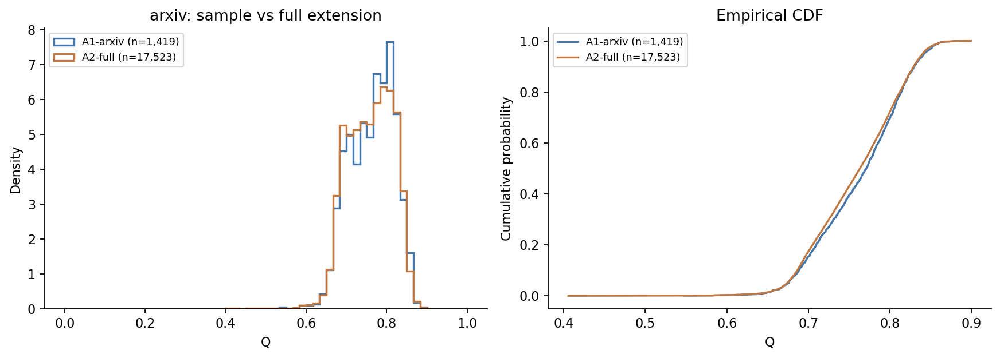

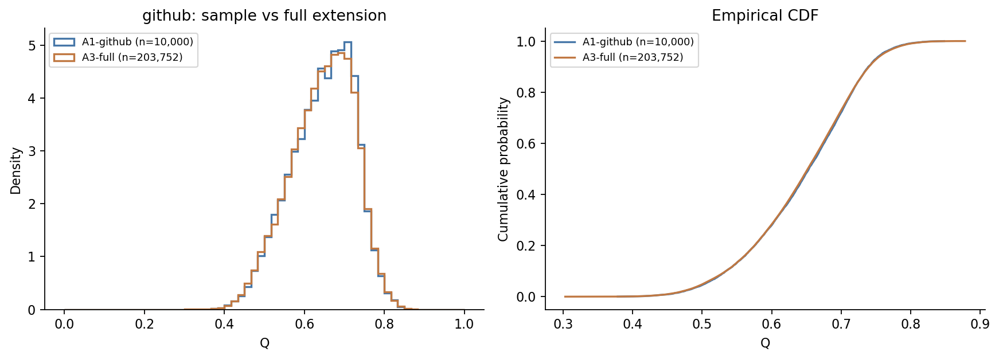

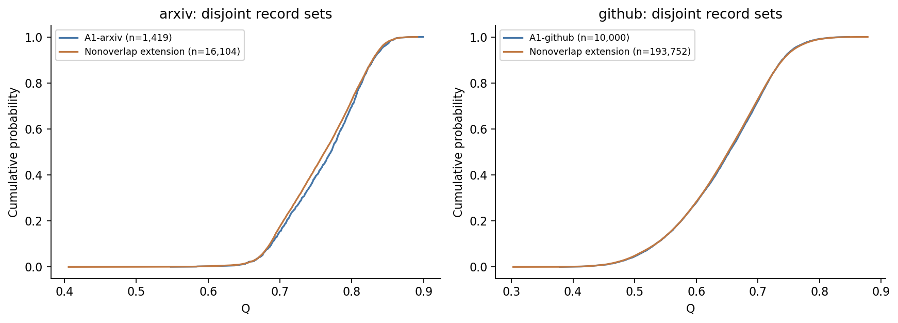

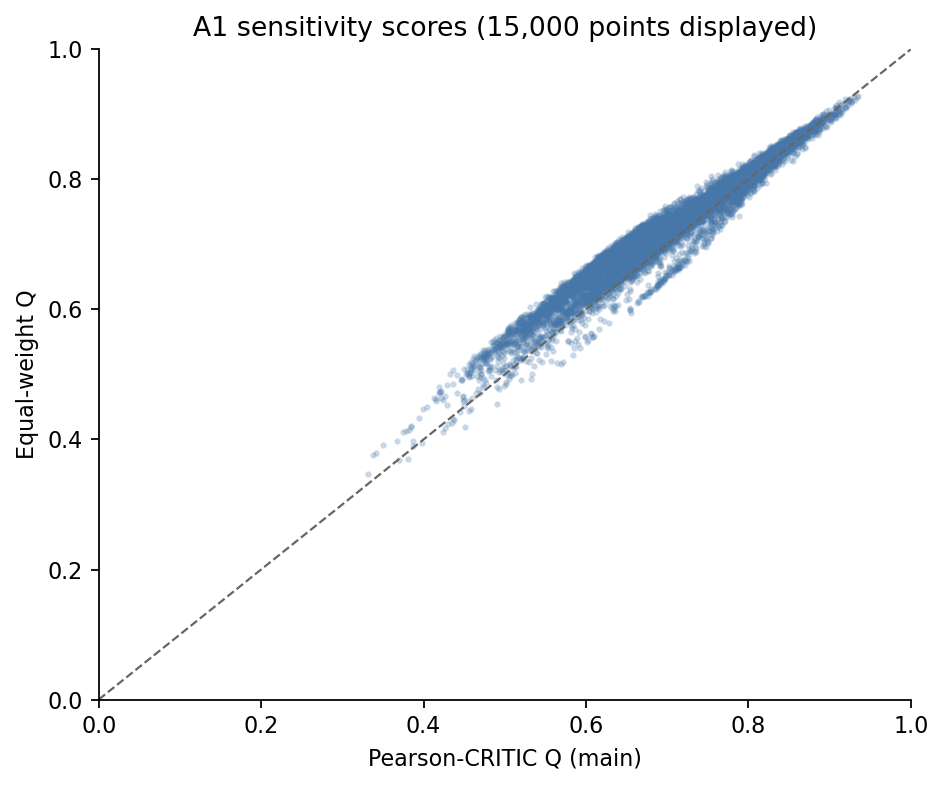

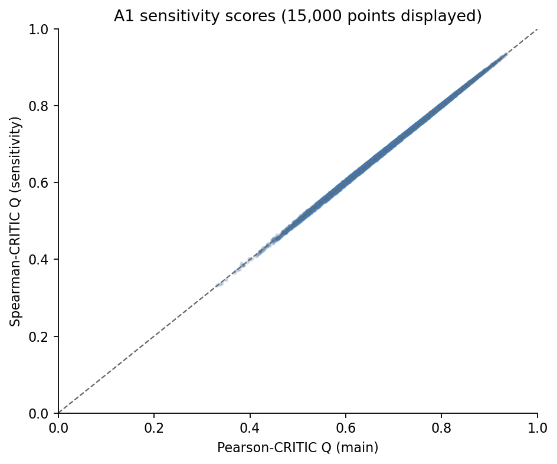

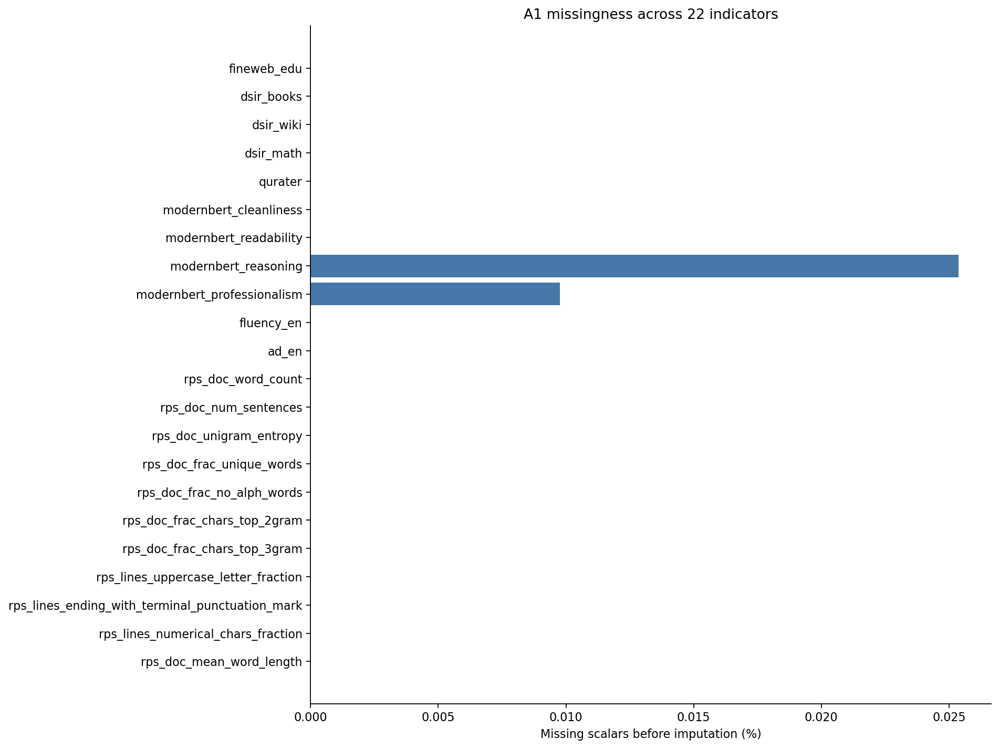

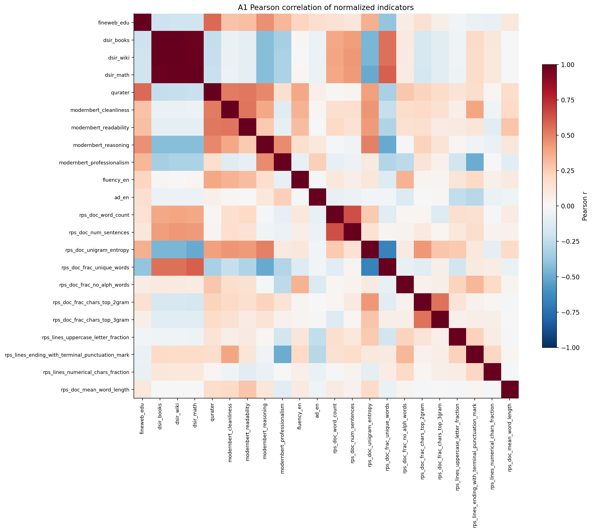

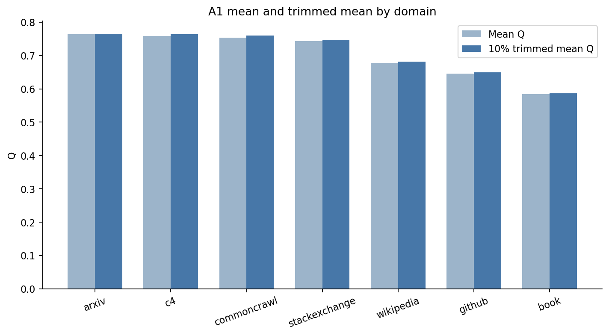

## 模型局限性与可复用文件

1. Q 是这 22 个已确认指标的加权效用，不是训练收益或事实正确性的直接测量。CRITIC 的方差/相关结构反映统计信息，不能证明指标语义有效。
2. A1 统一尺度使扩展集可比，也造成范围外截尾饱和；A2 的 DSIR/qurater 等大量截尾，以及分类天花板仍然存在。
3. P10–P90 平台压平内部差异，领域中位数填补会降低局部不确定性；当前未改变这些经确认的主方案。
4. 跨附件共享记录不应当作额外独立证据；非重叠对照改善这一点，仍不能证明真实训练数据总体代表性。
5. bootstrap 区间以当前记录独立重采样为基础，未建模文档来源聚类；显著性不能替代效应量与实际意义。
6. 高低各 20 条是有选择的极端材料，助手文本判读不是盲评或独立人工确认；不用于反向修正本次权重。

后续可直接复用 A1_sample_quality.csv、A2_arxiv_quality.csv、A3_github_quality.csv、A1 领域摘要、
固定 A1 模型/权重、非重叠 ID 索引和敏感性评分。但本阶段没有开始质量冲突消解、领域配比或其他问题。
