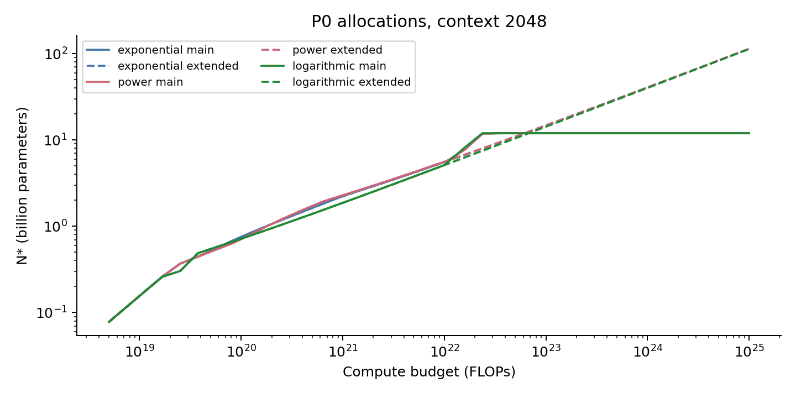
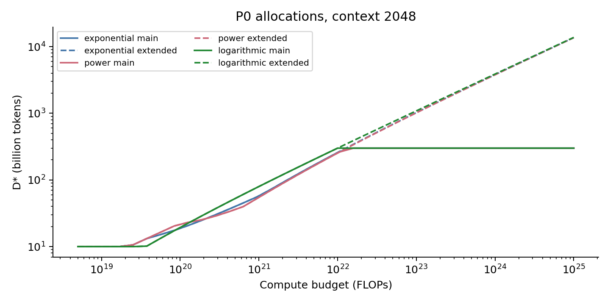
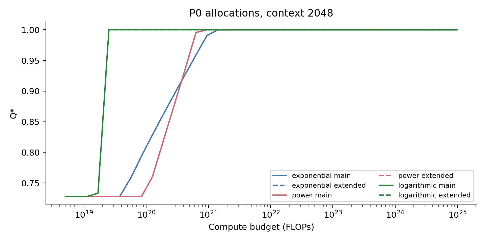
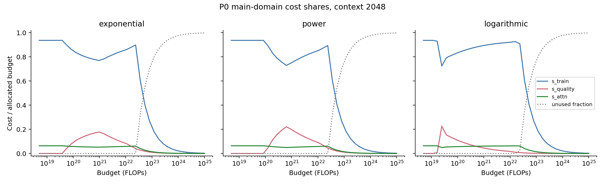
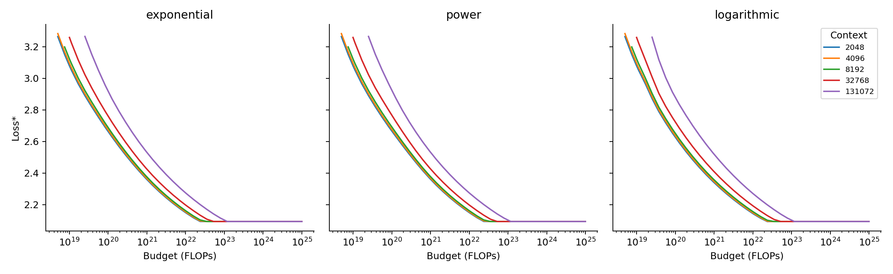
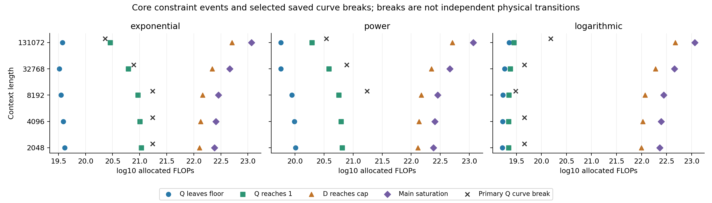
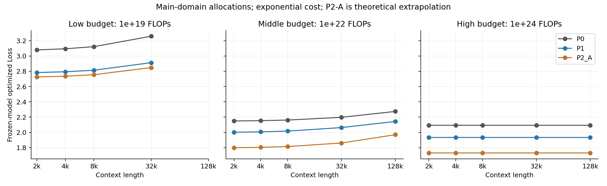
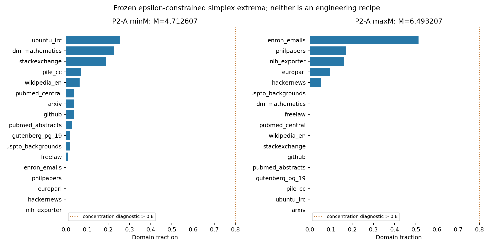

# 问题三最终报告：算力约束下的资源配置

问题一、问题二和问题三PHASE 1/2全部冻结。本报告读取已保存P0/P1、阈值、断点及敏感性结果；仅新增P2理论分析和收尾汇总。这里的配置是冻结模型下计算出的优化解，不是新增训练实验的观测值。

## 3.1 优化模型与成本构成

目标：$L_{gen}=E+A N_B^{-\alpha}+B D_B^{-\beta}+C_{Q,loss}(N_B/N_{0,B})^{-u_Q}(-\ln Q)+\lambda_p(N_B)[M(p)-M(p_{ref})]$。系数和lambda插值全部沿用问题二。

约束：$C_{train}+C_{quality}+C_{attn}\le C$；$C_{train}=6N_BD_B10^{18}$，$C_{attn}=\eta L_{ctx}N_BD_B10^{18}$，$C_{quality}=D_B10^9[g(Q)-g(Q_0)]_+$。p不进入成本。三个官方g平行保留，不评选哪个“正确”。

Q0=0.7280227164978084；主域N_B∈[0.070542,11.965825]，D_B∈[10,299.893]，Q∈[Q0,1]。它是证据支持的资源箱体，不能等同于箱内每个N-D-Q组合都做过实测验证。尤其Q=1高于A1实际样本质量上限，质量模块缺少完整联合N-D-Q直接验证。

## 3.2 解析降维与求解方法

由于$\partial L/\partial D_B<0$，$D_B^*=\min[D_{max},C/((6+\eta L_{ctx})N_B10^{18}+10^9\Delta g)]$。不强制花完预算。P0/P1直接采用PHASE 2结果；P2-A用相同二维资源求解器，并做独立DE复核，成本式未改变。

冻结一阶ILR模型可精确展开为$M(p)=a+\sum_j b_j\ln p_j$，$\sum b_j=0$。P2-A下界epsilon=0.00049900199600798399，是冻结零替换尺度，未新增更大下界。minM使正系数坐标取下界，剩余负系数按−b水位分配；maxM反之。这给出解析全局证书。

三类数值核验：DE在softmax/log-ratio空间搜索后梯度细化；32起点SLSQP；100,000个广泛Dirichlet点加20,000个靠近证书的定向Dirichlet点。随机点只给出可行值：采样最小值≥真实最小值、采样最大值≤真实最大值，不能把采样极值称为严格全局边界。DE/SLSQP与证书的误差详见P2_global_search.csv。

P2-B的重要结论：冻结规则只替换精确0，不截断任意小的正数。沿p_j=t→0+、其余分量为固定正比例，M=b_j ln t+O(1)。有正负系数，所以inf M=−∞、sup M=+∞，均不取到。精确t=0经零替换反而返回有限值，边界处不连续。因而不能合法报告P2-B有限p_minM/p_maxM，也不能靠新floor修补。所有可行官方资源场景lambda≠0时Loss下确界为−∞；lambda=0时配比项为0，所有配比等价。此为模型外推失效证据，不是可实现性能提升。

## 3.3 低中高预算最优配置

**表1：P0主域，代表上下文8192/32768；N、D单位均为B，Loss无量纲。**

| budget | cost_function | L_ctx | status | N_star | D_star | Q_star | L_star |
| --- | --- | --- | --- | --- | --- | --- | --- |
| 1e+19 | exponential | 8192 | SOLVED | 0.130917 | 10 | 0.728023 | 3.12279 |
| 1e+22 | exponential | 8192 | SOLVED | 5.07822 | 237.898 | 1 | 2.16171 |
| 1e+24 | exponential | 8192 | SOLVED | 11.9658 | 299.893 | 1 | 2.09338 |
| 1e+19 | exponential | 32768 | SOLVED | 0.0796584 | 10 | 0.728023 | 3.25912 |
| 1e+22 | exponential | 32768 | SOLVED | 3.97673 | 188.084 | 1 | 2.19759 |
| 1e+24 | exponential | 32768 | SOLVED | 11.9658 | 299.893 | 1 | 2.09338 |
| 1e+19 | power | 8192 | SOLVED | 0.130917 | 10 | 0.728023 | 3.12279 |
| 1e+22 | power | 8192 | SOLVED | 5.12297 | 234.045 | 1 | 2.16233 |
| 1e+24 | power | 8192 | SOLVED | 11.9658 | 299.893 | 1 | 2.09338 |
| 1e+19 | power | 32768 | SOLVED | 0.0796584 | 10 | 0.728023 | 3.25912 |
| 1e+22 | power | 32768 | SOLVED | 4.00496 | 185.625 | 1 | 2.19812 |
| 1e+24 | power | 32768 | SOLVED | 11.9658 | 299.893 | 1 | 2.09338 |
| 1e+19 | logarithmic | 8192 | SOLVED | 0.130917 | 10 | 0.728023 | 3.12279 |
| 1e+22 | logarithmic | 8192 | SOLVED | 4.71059 | 273.602 | 1 | 2.15669 |
| 1e+24 | logarithmic | 8192 | SOLVED | 11.9658 | 299.893 | 1 | 2.09338 |
| 1e+19 | logarithmic | 32768 | SOLVED | 0.0796584 | 10 | 0.728023 | 3.25912 |
| 1e+22 | logarithmic | 32768 | SOLVED | 3.74804 | 209.999 | 1 | 2.1934 |
| 1e+24 | logarithmic | 32768 | SOLVED | 11.9658 | 299.893 | 1 | 2.09338 |

低预算1e19：全部可行情景Q=Q0，P0的D=10B；131072上下文最低成本约2.27247e19，因此三类成本均不可行。中预算1e22：P0/P1全部Q=1。高预算1e24：P0/P1主域N/D/Q都达到上界。

主域P0高预算未用预算比例为88.3321%–97.6829%。其含义是已验证资源支持域饱和，现有模型无法可靠区分更大空间内配置；不能说真实训练最优只需要当前用量。扩展域单独标为scenario extrapolation。

## 3.4 结构性转移

**表2：Lctx=2048，三个成本函数的代表转移阈值；FLOPs。**

| cost_function | C_Q_leave | C_Q1 | C_D_leave | C_Dmax | C_saturation | C_peak_Q | max_s_Q |
| --- | --- | --- | --- | --- | --- | --- | --- |
| exponential | 4.10831e+19 | 1.06618e+21 | 2.24812e+19 | 1.27518e+22 | 2.39739e+22 | 1.06619e+21 | 0.180627 |
| logarithmic | 1.6667e+19 | 2.20343e+19 | 3.66998e+19 | 9.98031e+21 | 2.3171e+22 | 2.20342e+19 | 0.257802 |
| power | 1.02164e+20 | 6.49413e+20 | 2.24812e+19 | 1.30873e+22 | 2.40789e+22 | 6.49416e+20 | 0.223107 |

完整时间轴含所有既有Type I活跃集事件及Type II断点，没有重新检测。活跃集根括区间是数值定位误差；Type II沿用分块残差扰动区间，不是物理相变或参数不确定性的置信区间。

主域90条曲线中89条满足ΔBIC≥10；按最终规则，87条是primary curve diagnostics。它们仍不是同样数量的独立结构事件。A规则为距任一Type I事件≤0.5 log10预算；B规则为半径0.5 log10邻域内至少三种独立资源/成本类别。训练和注意力份额严格成比例，合并为同一类，不能重复计数。正文仅保留代表断点与硬约束事件。

主域15个质量成本份额路径均先升后降。峰值相对Q=1阈值的|log10(Cpeak/CQsat)|最大为5.65146e-06，系统性贴近质量饱和。每个成本×上下文的Cpeak、峰值份额和两种数值阈值材料均可追溯。这里Qsat使用PHASE 2已有target Q=1阈值，其容差与Type I active_Q_upper容差不同。

## 3.5 上下文长度临界分析

$C_{attn}/C_{train}=\eta L_{ctx}/6$，$L_{crit}=6/\eta=30000$。短上下文2048/4096/8192、临界附近32768、超长131072。此临界只表示两项成本相等，不表示性能最优上下文，也没有建模增加上下文可能带来的性能收益。

**表3：指数成本P0主域的五上下文对照；成本份额分母是分配预算。**

| budget | L_ctx | ratio_attention_training | status | N_star | D_star | L_star | s_train | s_quality | s_attn |
| --- | --- | --- | --- | --- | --- | --- | --- | --- | --- |
| 1e+19 | 2048 | 0.0682667 | SOLVED | 0.156016 | 10 | 3.07978 | 0.936096 | 0 | 0.0639041 |
| 1e+22 | 2048 | 0.0682667 | SOLVED | 5.5421 | 257.945 | 2.14974 | 0.857734 | 0.0837115 | 0.0585546 |
| 1e+24 | 2048 | 0.0682667 | SOLVED | 11.9658 | 299.893 | 2.09338 | 0.0215308 | 0.00097325 | 0.00146984 |
| 1e+19 | 4096 | 0.136533 | SOLVED | 0.146645 | 10 | 3.09469 | 0.879869 | 0 | 0.120131 |
| 1e+22 | 4096 | 0.136533 | SOLVED | 5.37324 | 250.711 | 2.15393 | 0.808279 | 0.0813639 | 0.110357 |
| 1e+24 | 4096 | 0.136533 | SOLVED | 11.9658 | 299.893 | 2.09338 | 0.0215308 | 0.00097325 | 0.00293967 |
| 1e+19 | 8192 | 0.273067 | SOLVED | 0.130917 | 10 | 3.12279 | 0.785505 | 0 | 0.214495 |
| 1e+22 | 8192 | 0.273067 | SOLVED | 5.07822 | 237.898 | 2.16171 | 0.724859 | 0.0772056 | 0.197935 |
| 1e+24 | 8192 | 0.273067 | SOLVED | 11.9658 | 299.893 | 2.09338 | 0.0215308 | 0.00097325 | 0.00587934 |
| 1e+19 | 32768 | 1.09227 | SOLVED | 0.0796584 | 10 | 3.25912 | 0.477951 | 0 | 0.522049 |
| 1e+22 | 32768 | 1.09227 | SOLVED | 3.97673 | 188.084 | 2.19759 | 0.448777 | 0.0610395 | 0.490184 |
| 1e+24 | 32768 | 1.09227 | SOLVED | 11.9658 | 299.893 | 2.09338 | 0.0215308 | 0.00097325 | 0.0235174 |
| 1e+19 | 131072 | 4.36907 | INFEASIBLE | — | — | — | — | — | — |
| 1e+22 | 131072 | 4.36907 | SOLVED | 2.52738 | 118.115 | 2.27431 | 0.179113 | 0.0383322 | 0.782555 |
| 1e+24 | 131072 | 4.36907 | SOLVED | 11.9658 | 299.893 | 2.09338 | 0.0215308 | 0.00097325 | 0.0940695 |

跨8192→32768时，注意力/训练成本比从0.273067变为1.09227。未饱和中预算N和D下降、Loss上升；低预算D卡下界不变而N下降。高预算主域尺寸已经饱和，不再压缩N/D或改变Loss，但注意力消耗增加、未用预算下降。

## 3.6 质量成本函数敏感性

三种成本主要改变质量投资时机、峰值与阈值，也会改变局部早期阶段顺序。Lctx=2048时，指数/幂成本先退出D下界再提高质量；对数成本先提高质量并达到Q=1后才退出D下界。因此不能写“各成本完全保持相同阶段顺序”。相同官方低预算P0结果一致，中预算配置和Loss略有差异，高预算主域均饱和。完整五上下文顺序见cost_function_transition_summary.csv。

## 3.7 领域配比优化：P0/P1/P2

**表4：Lctx=8192，主域各官方预算下优化Loss；P2-A仅为理论配比外推。**

| budget | cost_function | P0 | P1 | P2_A | P2_B | evidence |
| --- | --- | --- | --- | --- | --- | --- |
| 1e+19 | exponential | 3.12279 | 2.81406 | 2.75544 | 无有限最优解 | P2_A为配比外推；P1按实际最优N判定lambda证据 |
| 1e+19 | logarithmic | 3.12279 | 2.81406 | 2.75544 | 无有限最优解 | P2_A为配比外推；P1按实际最优N判定lambda证据 |
| 1e+19 | power | 3.12279 | 2.81406 | 2.75544 | 无有限最优解 | P2_A为配比外推；P1按实际最优N判定lambda证据 |
| 1e+22 | exponential | 2.16171 | 2.01704 | 1.81473 | 无有限最优解 | P2_A为配比外推；P1按实际最优N判定lambda证据 |
| 1e+22 | logarithmic | 2.15669 | 2.01399 | 1.81188 | 无有限最优解 | P2_A为配比外推；P1按实际最优N判定lambda证据 |
| 1e+22 | power | 2.16233 | 2.01743 | 1.8151 | 无有限最优解 | P2_A为配比外推；P1按实际最优N判定lambda证据 |
| 1e+24 | exponential | 2.09338 | 1.93528 | 1.7296 | 无有限最优解 | P2_A为配比外推；P1按实际最优N判定lambda证据 |
| 1e+24 | logarithmic | 2.09338 | 1.93528 | 1.7296 | 无有限最优解 | P2_A为配比外推；P1按实际最优N判定lambda证据 |
| 1e+24 | power | 2.09338 | 1.93528 | 1.7296 | 无有限最优解 | P2_A为配比外推；P1按实际最优N判定lambda证据 |

P2_A minM：max share=25.3648%，H=2.05826，Hnorm=0.726476，Neff=7.83233，HHI=0.166986；距参考L1/L2/JS=1.03732/0.352912/0.427969。最近经验L1/JS=0.777184/0.313328；超经验坐标范围领域数=0；unsupported_mixture_extrapolation=True。

P2_A maxM：max share=51.3200%，H=1.36418，Hnorm=0.481495，Neff=3.9125，HHI=0.330575；距参考L1/L2/JS=1.80889/0.617635/0.735974。最近经验L1/JS=1.62377/0.712227；超经验坐标范围领域数=2；unsupported_mixture_extrapolation=True。

P1 minM：max share=35.3230%，H=1.67096，Hnorm=0.589776，Neff=5.31727，HHI=0.225481；距参考L1/L2/JS=1.17584/0.374201/0.502374。最近经验L1/JS=0/3.69607e-09；超经验坐标范围领域数=0；unsupported_mixture_extrapolation=False。

P1 maxM：max share=88.2131%，H=0.559206，Hnorm=0.197375，Neff=1.74928，HHI=0.781631；距参考L1/L2/JS=1.55628/0.799233/0.637981。最近经验L1/JS=0/0；超经验坐标范围领域数=0；unsupported_mixture_extrapolation=False。

两个P2-A端点都没有触发maxshare>0.8或Neff<2的集中阈值，更未触发maxshare>0.95的近退化阈值；不能预设纯simplex必然单域退化。但最优配方均偏离经验配方集，仍属unsupported mixture extrapolation。此标记依据坐标越界或最近距离超过832候选leave-one-out最近邻距离P95；是数据驱动的稀疏性诊断，不是统计置信区域。

P1的minM/maxM来自832个冻结实测配方。它们的完整17域、来源成员、模型值及集中度见附录；maxM配方本身最大单域88.21%，Neff<2，是高度集中的经验配方，经验可行不代表分散。lambda>0选择minM；lambda<0选择maxM；条件性变号来自估计的大尺度迁移节点，不能理解为新的大模型训练观测。

推荐层级：Conservative=主域P0；Empirical-enhanced=主域P1，其中60M–1B真实节点区间内增益证据较强，>1B估计节点依赖，>70B为lambda外推；Exploratory=扩展域和/或P2。P2不进入工程推荐。建议以P0作为主结论，P1作为按证据层级注明的增强方案。分类按各自最优N判断，不按预算自动划分。

固定同一N/D/Q/Lctx的成本不变量核验已输出，P2收益仅来自冻结配比项及由此引起的资源重新分配，成本公式完全一致。

## 3.8 鲁棒性与证据边界

**表5：核心结论的鲁棒性及已核验范围。**

| conclusion_id | conclusion | robustness | verified_scope |
| --- | --- | --- | --- |
| A | 低预算质量保持Q0 | robust | P0/P1主域，三个成本、全部可行官方低预算上下文及已有Q0敏感性 |
| B | 中预算Q=1 | moderately_sensitive | P0/P1，C=1e22，三成本五上下文；Q0已有敏感性 |
| C | 高预算主域饱和 | robust | P0/P1，C=1e24，三成本五上下文及Q0敏感性 |
| D | 质量成本份额先升后降且峰值靠近Q饱和 | robust | 冻结P0主/扩展域30条路径；主域15个峰值 |
| E | 长上下文压缩N/D并提高Loss | moderately_sensitive | P0/P1未饱和的可行预算情景 |
| F | 经验配比优化改善Loss | highly_sensitive | P1经验可行集内条件性模型收益；低预算真实节点更可信 |
| G | 具体转移预算保持稳定 | highly_sensitive | 数值根括区间精度高；不是模型参数不确定性区间 |

六种敏感性来源在robustness_summary.csv逐项列出：成本函数、Q0、上下文、P0/P1/P2、主/扩展域、lambda证据。robust均限制在明示的已验证范围；Q0只沿用已有官方场景敏感性，未重新检测转移；未计算P1/P2完整预算路径，不能声称其质量份额峰值规律已经验证。模型箱体内仍有插值/模块组合假设，不能称全部结果“直接实测支持”。

## 3.9 问题三结论

1. 解析消去D和按lambda符号选配方，使资源优化降为二维；P0/P1历史结果保持冻结，P2-A另有全局配方证书。
2. 官方低预算优先保留质量基线，中预算质量达到模型上界，高预算主域饱和；对应证据和适用范围必须写清。
3. 质量投资份额先升后降，15个主域峰值均靠近质量饱和；成本形状改变时机，部分改变早期阶段顺序。
4. 30000为成本临界，上下文增加使未饱和配置承受更高注意力负担；不是性能最优点。
5. 主推荐P0，P1作为证据分层的经验增强；P2-A虽未单域退化仍远离实测配方，P2-B无界，均不得工程部署。
6. 精确转移阈值、配比迁移收益和大资源外推高度依赖假设；1e24未用预算反映证据域饱和。

## 附录与复现

新脚本：`python -X utf8 -B scripts/19_finalize_compute_optimization.py --stage simplex|official|report`；完整运行可用`--stage all`。脚本使用pathlib自动定位项目根。只有新phase3输出会更新；现有阶段文件不修改。

- [P2_global_search.csv](../optimization/phase3/P2_global_search.csv)

- [P2_A_extreme_recipes.csv](../optimization/phase3/P2_A_extreme_recipes.csv)

- [P2_B_boundary_limit_witness.csv](../optimization/phase3/P2_B_boundary_limit_witness.csv)

- [P2_B_exact_zero_vertices.csv](../optimization/phase3/P2_B_exact_zero_vertices.csv)

- [P1_final_recipes.csv](../optimization/phase3/P1_final_recipes.csv)

- [recipe_concentration_and_support.csv](../optimization/phase3/recipe_concentration_and_support.csv)

- [empirical_distance_calibration.csv](../optimization/phase3/empirical_distance_calibration.csv)

- [P2_empirical_coordinate_support.csv](../optimization/phase3/P2_empirical_coordinate_support.csv)

- [P0_P1_P2_official_comparison.csv](../optimization/phase3/P0_P1_P2_official_comparison.csv)

- [recommendation_tiers.csv](../optimization/phase3/recommendation_tiers.csv)

- [structural_transition_timeline.csv](../optimization/phase3/structural_transition_timeline.csv)

- [typeII_final_classification.csv](../optimization/phase3/typeII_final_classification.csv)

- [quality_share_peak_vs_saturation.csv](../optimization/phase3/quality_share_peak_vs_saturation.csv)

- [cost_function_transition_summary.csv](../optimization/phase3/cost_function_transition_summary.csv)

- [context_final_summary.csv](../optimization/phase3/context_final_summary.csv)

- [robustness_summary.csv](../optimization/phase3/robustness_summary.csv)

- [high_budget_main_saturation.csv](../optimization/phase3/high_budget_main_saturation.csv)

- [fixed_resource_cost_invariance.csv](../optimization/phase3/fixed_resource_cost_invariance.csv)

- [final_figure_manifest.csv](../optimization/phase3/final_figure_manifest.csv)

- [input_manifest.csv](../optimization/phase3/input_manifest.csv)

- [implementation_manifest.csv](../optimization/phase3/implementation_manifest.csv)

- [independent_verification.csv](../optimization/phase3/independent_verification.csv)

- [verification_summary.json](../optimization/phase3/verification_summary.json)

附录图：复用PHASE 2的N/D/Q路径、成本份额及上下文图，新图仅补P0/P1/P2-A比较、17域simplex配方、核心事件时间轴。

独立公式/输出及冻结文件SHA256核验结果以附录verification_summary.json为准。运行`python -X utf8 -B scripts/19_verify_final_optimization.py`可独立复核；不需要重跑PHASE 2。

问题三至此结束。没有开始问题四，没有改动冻结附件、预处理、质量权重、Q/K、ILR/ElasticNet、Scaling Law、lambda或PHASE 2优化结果。
