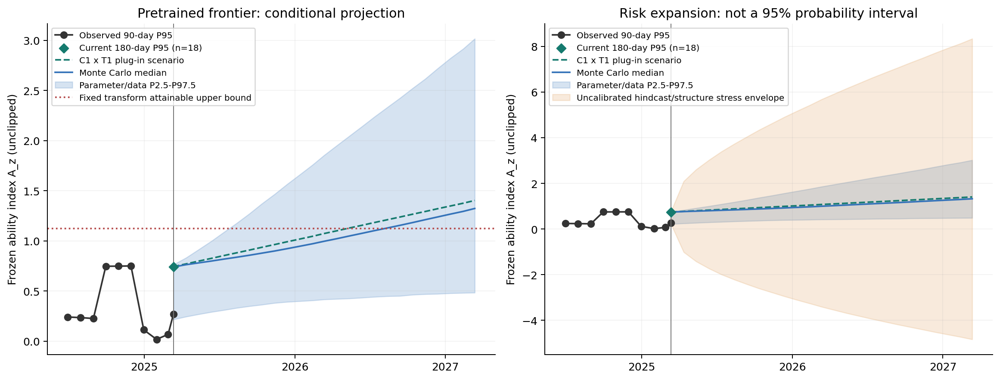
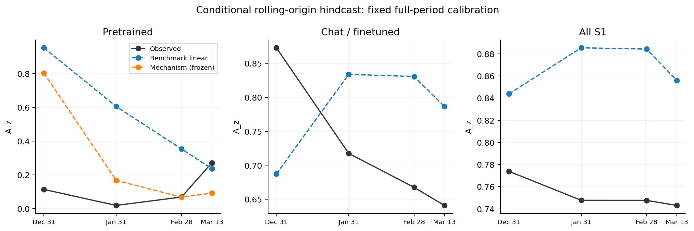
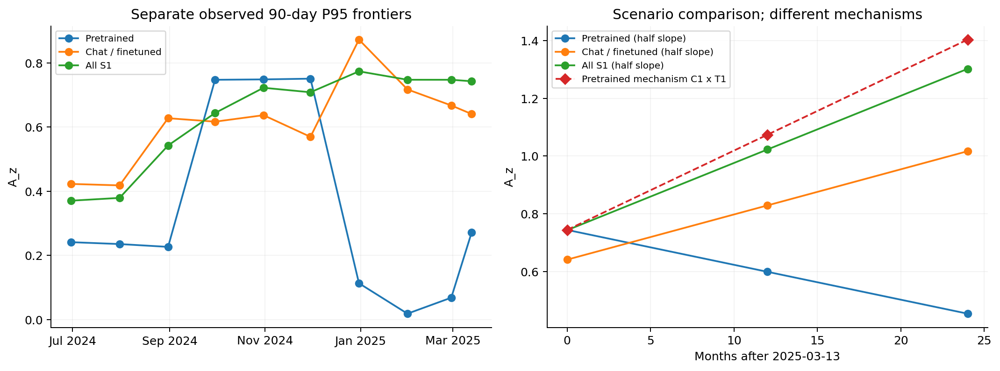
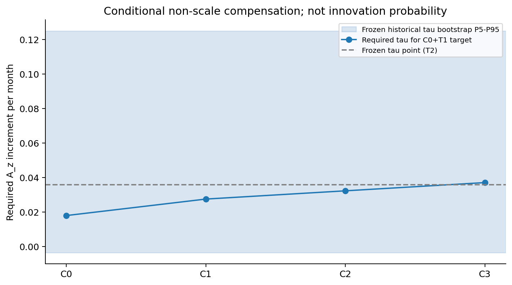

# 问题四最终报告：算力增长放缓下的情景化能力前沿投影

基于附件快照，T0=2025-03-13；未来日期为2026-03-13、2027-03-13。这是相对于附件历史起点的12/24个月情景投影，不是相对于运行日的新预测。问题一至三、问题四PHASE1/2的结果保持冻结。PHASE3只新建算力增长、前沿统计、Benchmark-only对照、情景传播及诊断。

**定位：scenario-based frontier projection。** 以下点情景、条件参数/数据区间、扩大风险包络分别输出；不宣称可靠长期点预测、不把情景设定赋予发生概率。

## 4.1 数据与开源模型口径〔Level A〕

冻结C1/C2各4576条原记录、4497个去重模型，S0=4497、S1=422、S2=0。S1表示附件明确确认开放权重，不能据此证明严格开源许可证授权。当前有效S1分类：

| model_type | n |
| --- | --- |
| chat_finetuned | 229 |
| other_unknown | 127 |
| pretrained | 66 |

F0仅pretrained进入M2-C机制投影；F1 chat_finetuned仅Benchmark趋势；F2包含S1全部类型，仅描述实际开源权重能力前沿。提交日期既不一定是模型发布日期，也不一定是当时真实评测日；快照去重产生存留与选择效应。因此“历史前沿”严格说是当前附件按提交月份回溯的样本前沿。冻结详细证据见[PHASE1报告](question4_phase1_data_ability_bridge.md)与[PHASE2报告](question4_phase2_contribution_decomposition.md)。

本阶段真实读取冻结evolution_model_table.csv、ability_transform_parameters.json、model_definitions.json、coefficient_bootstrap.csv及各诊断表；原始C4 epoch_all_ai_models.csv仅用于新的算力趋势，原始C3 leaderboard_extended_timeseries.csv仅用于年份/参数方向检查。input_manifest.csv逐文件保留路径与SHA256。没有读取旧版问题四预测作为结论依据。

## 4.2 综合能力指标〔Level A〕

主指标为六个官方Benchmark的等权稳健标准化：$A_z=\frac16\sum_k(\operatorname{clip}(x_k,P01_k,P99_k)-m_k)/IQR_k$，指标顺序IFEval, BBH, MATH Lvl 5, GPQA, MUSR, MMLU-PRO。全部使用冻结S1全期阈值，不月度重拟合。PCA只是冻结敏感性，不替换主指标。A100显示使用原映射P01=-0.831327467、P99=0.856302240，未来值不重新归一化。

标准化分数本身没有天然上界，但**当前冻结的逐任务Winsor公式有操作性可实现范围 [-0.917149,1.123255]**。本阶段不修改公式、不给外推偷偷截断。超界原始A_z和A100仍保存并标记；它们只能表示增量模型的外推信号，不能作为该冻结Benchmark指标可实现的未来分数。A_100_unclipped与A_100_clipped_for_plot同时输出；正文用未截断A_z。这里没有新增logistic饱和上限。

## 4.3 C8细粒度能力检验〔Level A〕

冻结C8同轮与快照弱尾诊断：

| sample | ability_basis | n | high_average_weak_tail_count | high_average_weak_tail_rate |
| --- | --- | --- | --- | --- |
| S0 | C2_snapshot | 1851 | 15 | 0.00810373 |
| S0 | C8_same_run | 1851 | 6 | 0.00324149 |
| S1 | C2_snapshot | 205 | 1 | 0.00487805 |
| S1 | C8_same_run | 205 | 0 | 0 |

不能把版本差异解释成模型退化。当前pretrained锚点C8敏感性如下；阈值是有C8的S1 pretrained样本imbalance P90，而不是主观筛选。未知C8保留并单列。

| sample | n | known_C8_n | unknown_C8_n | imbalance_P90 | P95 | P90 | Top3 | maximum |
| --- | --- | --- | --- | --- | --- | --- | --- | --- |
| all_anchor_models | 18 | 6 | 12 | 62.4518 | 0.744117 | 0.549531 | 0.657352 | 0.763786 |
| exclude_known_top10_imbalance | 17 | 5 | 12 | 62.4518 | 0.526857 | 0.421453 | 0.540694 | 0.763786 |
| C8_complete_only | 6 | 6 | 0 | 62.4518 | 0.653152 | 0.565659 | 0.361213 | 0.740646 |

排除1个已知最高10%偏科模型后，P95下降0.217260；12/18模型C8未知。差异明显，不能说前沿不受偏科影响。将绝对锚点差作为结构压力包络的一项，未把缺失C8当作“无偏科”。

## 4.4 规模与非规模进步分解〔Level B〕

冻结回归HC3诊断，不重新拟合：

| model | term | n | coef | CI_low | CI_high | p_value |
| --- | --- | --- | --- | --- | --- | --- |
| M1_linear | intercept | 66 | -0.789943 | -0.906518 | -0.673368 | 2.55186e-20 |
| M1_linear | lnN | 66 | 0.182341 | 0.120604 | 0.244078 | 1.55607e-07 |
| M1_linear | t_month | 66 | 0.0426116 | 0.00500881 | 0.0802144 | 0.0269919 |
| M2_C | intercept | 21 | -8.63085 | -13.1832 | -4.0785 | 0.000871918 |
| M2_C | lnC | 21 | 0.156425 | 0.0697413 | 0.243109 | 0.00133731 |
| M2_C | t_month | 21 | 0.0358582 | -0.0165969 | 0.0883133 | 0.168102 |
| M3_ND | intercept | 21 | -7.3219 | -11.2278 | -3.41595 | 0.00102229 |
| M3_ND | lnN | 21 | 0.0778226 | -0.0634518 | 0.219097 | 0.261205 |
| M3_ND | lnD | 21 | 0.243112 | 0.0929469 | 0.393277 | 0.0032938 |
| M3_ND | t_month | 21 | 0.0257221 | -0.0251887 | 0.0766329 | 0.301348 |

M1控制参数规模，M2控制训练算力，M3控制N、D；时间项是非规模进步代理的条件关联，不是因果技术效应或RLHF效率。M2只有21条完整记录，tau的HC3区间跨0，Bootstrap中323/5000个tau为负，本轮原样保留。组织依赖、样本选择和时间口径限制已在冻结PHASE2中验证，不因本轮情景计算而消失。

历史主窗口R1/R2/R3：

| series | n | early_n | late_n | Delta_scale | Delta_tech | Delta_pred | absolute_share_scale | absolute_share_tech |
| --- | --- | --- | --- | --- | --- | --- | --- | --- |
| R1 | 66 | 48 | 6 | -0.140117 | 0.321293 | 0.181176 | 0.303672 | 0.696328 |
| R2 | 21 | 17 | 2 | -0.460504 | 0.270372 | -0.190131 | 0.630071 | 0.369929 |
| R3 | 21 | 17 | 2 | -0.21308 | 0.193946 | -0.0191349 | 0.523506 | 0.476494 |

这些absolute share只描述过去抵消项的绝对贡献，**没有被乘以未来增长**。未来分解严格使用beta_C×未来log算力增量和tau×情景时间增量。冻结M2的LOOCV亦只支持有限的关联泛化：

| model | n | RMSE | MAE | R2 |
| --- | --- | --- | --- | --- |
| M1_linear | 66 | 0.353399 | 0.297219 | 0.358706 |
| M2_C | 21 | 0.350965 | 0.300982 | 0.527751 |
| M3_ND | 21 | 0.333698 | 0.26188 | 0.573077 |

## 4.5 Loss-Benchmark桥接负结果〔Level A/B：不成立〕

C6 High仅7个、全部Pythia；Medium=68。B0/B1/B2均未取得可靠CV泛化：

| candidate | evaluation | n | RMSE | MAE | R2 |
| --- | --- | --- | --- | --- | --- |
| B0 | High_LOMO_CV | 7 | 0.0519036 | 0.0413291 | -1.27906 |
| B0 | Medium_external | 68 | 0.798718 | 0.646585 | -1.99184 |
| B1 | High_LOMO_CV | 7 | 0.0509694 | 0.0353528 | -1.19776 |
| B1 | Medium_external | 68 | 0.725797 | 0.587308 | -1.47048 |
| B2 | High_LOMO_CV | 7 | 0.0457282 | 0.0324989 | -0.769003 |
| B2 | Medium_external | 68 | 0.771282 | 0.623263 | -1.78983 |

B2是常数保序回归诊断，bridge_valid_for_conversion=False。不能把前三问Loss可靠转换为第四问Benchmark；本轮没有使用任何Loss桥接数值。前三问与本问通过scale/compute资源变量及机制解释联系。

## 4.6 能力前沿定义〔Level A〕

按样本数量依次90→120→180天，仅不足20才扩大，不追求更高前沿；达到180天仍不足就保留并警示。主定义P95，P90与Top3敏感性；maximum只存在辅助附录统计，未作为主锚点。

| model_scope | frontier_definition | base_date | window_days | n | A_z_anchor | anchor_below_minimum |
| --- | --- | --- | --- | --- | --- | --- |
| F0_pretrained | P95 | 2025-03-13 | 180 | 18 | 0.744117 | True |
| F0_pretrained | Top3 | 2025-03-13 | 180 | 18 | 0.657352 | True |
| F0_pretrained | P90 | 2025-03-13 | 180 | 18 | 0.549531 | True |
| F1_chat | P95 | 2025-03-13 | 90 | 102 | 0.64094 | False |
| F1_chat | Top3 | 2025-03-13 | 90 | 102 | 0.705402 | False |
| F1_chat | P90 | 2025-03-13 | 90 | 102 | 0.573213 | False |
| F2_overall | P95 | 2025-03-13 | 90 | 204 | 0.743053 | False |
| F2_overall | Top3 | 2025-03-13 | 90 | 204 | 0.799546 | False |
| F2_overall | P90 | 2025-03-13 | 90 | 204 | 0.707392 | False |

pretrained只有18条，必须承认锚点稀疏。历史Benchmark-only与hindcast固定90天滚动前沿，主机制当前锚点按规则扩大180天，二者不是同一窗口。Top3指现有最多3条模型的均值；Bootstrap重复条目属于重采样经验分布，不伪称新的不同模型。

## 4.7 算力增长趋势〔Level C所需历史输入〕

C4由冻结S1 pretrained可靠映射：38条匹配记录属于37个不同训练项目，按epoch_row去重。最近36个月有34个原始去重项目达到20要求；向前多6个月的滚动起始上下文共35个，Bootstrap重采样上下文模型，重算所有滚动窗口，避免把重叠窗口当独立观测。

| method | frontier_definition | monthly_log_growth | annualized_multiplier | CI_low | CI_high | bootstrap_draws | recent_unique_models |
| --- | --- | --- | --- | --- | --- | --- | --- |
| TheilSen | P90 | 0.122122 | 4.32956 | 0.0601046 | 0.201761 | 5000 | 34 |
| OLS | P90 | 0.12297 | 4.37382 | 0.0712712 | 0.203693 | 5000 | 34 |
| TheilSen | P95 | 0.128461 | 4.67173 | 0.0644624 | 0.188771 | 5000 | 34 |
| OLS | P95 | 0.132368 | 4.89601 | — | — | 0 | 34 |
| TheilSen | Top3 | 0.109851 | 3.73674 | 0.0485668 | 0.187403 | 5000 | 34 |
| OLS | Top3 | 0.117237 | 4.08306 | — | — | 0 | 34 |
| QuantReg_tau0.9 | conditional_P90 | 0.170819 | 7.76656 | — | — | 0 | 34 |

主Theil-Sen是两点斜率中位数，主响应6个月滚动P90 logCompute；OLS与P95/Top3敏感性同为滚动前沿，QuantReg tau=.9是个体模型条件分位数，估计对象不同。方法参照[SciPy Theil-Sen定义](https://docs.scipy.org/doc/scipy/reference/generated/scipy.stats.theilslopes.html)和[statsmodels QuantReg](https://www.statsmodels.org/v0.14.4/generated/statsmodels.regression.quantile_regression.QuantReg.fit.html)。主5000模型Bootstrap月度斜率区间保留全部有效结果，不强制增长非负、不施加单调包络。OLS-P95/Top3及QuantReg只有点敏感性，没有伪造Bootstrap区间。

最新有算力项目日期2024-09-19，滞后T0 175天；这不是全球算力普查。样本来自被Leaderboard匹配到的开放pretrained项目，算力估计及发布时间本身也有误差，5000次重采样不能消除选择偏差。C3按年份/来源的模型数与N统计保留在C3_long_run_direction_audit.csv，26条历史补充记录没有拼入A_z。

## 4.8 算力放缓情景〔Level C〕

| compute_scenario | factor | monthly_log_growth | annualized_multiplier | assumption |
| --- | --- | --- | --- | --- |
| C0 | 1 | 0.122122 | 4.32956 | True |
| C1 | 0.5 | 0.0610611 | 2.08076 | True |
| C2 | 0.25 | 0.0305306 | 1.44248 | True |
| C3 | 0 | 0 | 1 | True |

情景系数1、.5、.25、0是题设假设，不是数据估计；C1为主，C0只是无放缓参照。T0/T1/T2对应0、.5、1倍冻结非规模时间代理，T1为中性主情景，不称最可能。主增量公式：

$$A(h)=A_{anchor}+\beta_C g_C f_C h+\tau_C f_T h.$$

beta_C=0.156425027723，tau_C=0.035858207904，h=12/24。把横截面条件均值斜率迁移到P95前沿是附加不变性假设，没有重新拟合分位能力模型。24主情景加P90/Top3敏感性共72条机制结果；另18条Benchmark-only结果，全表90条。Monte Carlo 10000次：同一冻结系数Bootstrap行抽beta/tau，算力与锚点Bootstrap各独立抽取；三块可能共享模型，独立块假设仍可能低估协方差，未假装完整联合世界概率模型。240000条主情景draw保留在frontier_projection_mc.csv，mc_joint_draws.csv保留每块replicate可复算。

## 4.9 未来12个月前沿〔Level C〕

| horizon_months | forecast_date | A_z_point | A_z_median | A_z_P2.5 | A_z_P10 | A_z_P90 | A_z_P97.5 | expanded_risk_low | expanded_risk_high | risk_level |
| --- | --- | --- | --- | --- | --- | --- | --- | --- | --- | --- |
| 12 | 2026-03-13 | 1.07388 | 0.996713 | 0.416554 | 0.64111 | 1.30045 | 1.85452 | -3.40825 | 5.67932 | HIGH |

点情景是插入原估计所得，MC中位数来自重采样传播，不必相等。以下P2.5/P97.5只是参数/数据分位数。主P95方案全部12个月情景：

| compute_scenario | technology_scenario | A_z_point | A_z_median | A_z_P2.5 | A_z_P97.5 | risk_level |
| --- | --- | --- | --- | --- | --- | --- |
| C0 | T0 | 0.973352 | 0.896481 | 0.408795 | 1.1256 | HIGH |
| C0 | T1 | 1.1885 | 1.10452 | 0.484933 | 1.94127 | VERY_HIGH |
| C0 | T2 | 1.40365 | 1.32372 | 0.484222 | 3.01665 | VERY_HIGH |
| C1 | T0 | 0.858735 | 0.821115 | 0.316717 | 0.940169 | HIGH |
| C1 | T1 | 1.07388 | 0.996713 | 0.416554 | 1.85452 | HIGH |
| C1 | T2 | 1.28903 | 1.21045 | 0.422619 | 2.93066 | VERY_HIGH |
| C2 | T0 | 0.801426 | 0.78445 | 0.268198 | 0.84965 | HIGH |
| C2 | T1 | 1.01657 | 0.94486 | 0.377089 | 1.81445 | HIGH |
| C2 | T2 | 1.23172 | 1.15339 | 0.3914 | 2.89223 | VERY_HIGH |
| C3 | T0 | 0.744117 | 0.740646 | 0.217258 | 0.763786 | HIGH |
| C3 | T1 | 0.959266 | 0.890544 | 0.330863 | 1.77492 | VERY_HIGH |
| C3 | T2 | 1.17442 | 1.09624 | 0.349952 | 2.84848 | VERY_HIGH |

## 4.10 未来24个月前沿〔Level D〕

| horizon_months | forecast_date | A_z_point | A_z_median | A_z_P2.5 | A_z_P10 | A_z_P90 | A_z_P97.5 | expanded_risk_low | expanded_risk_high | risk_level |
| --- | --- | --- | --- | --- | --- | --- | --- | --- | --- | --- |
| 24 | 2027-03-13 | 1.40365 | 1.32372 | 0.484222 | 0.814163 | 1.87886 | 3.01665 | -4.83488 | 8.33574 | VERY_HIGH |

24个月点情景1.403651与MC中位数1.323725均超出冻结操作性上界1.123255，不可当作可实现Benchmark分数。继续保留未截断数值作为压力外推，以VERY_HIGH标识。相对观测max/P99、超过max+2IQR、超过冻结可实现范围分别诊断，不能相互替代。

F1/F2只做flat、50%、full slope延续，不套用M2：

| model_scope | horizon_months | technology_scenario | A_z_point | A_z_median | A_z_P2.5 | A_z_P97.5 | risk_level |
| --- | --- | --- | --- | --- | --- | --- | --- |
| F0_pretrained | 12 | flat | 0.744117 | 0.740646 | 0.217258 | 0.763786 | HIGH |
| F0_pretrained | 12 | half_slope | 0.598948 | 0.31224 | -0.339911 | 0.782647 | HIGH |
| F0_pretrained | 12 | full_slope | 0.45378 | -0.0337841 | -1.1279 | 0.809215 | VERY_HIGH |
| F0_pretrained | 24 | flat | 0.744117 | 0.740646 | 0.217258 | 0.763786 | VERY_HIGH |
| F0_pretrained | 24 | half_slope | 0.45378 | -0.0337841 | -1.1279 | 0.809215 | VERY_HIGH |
| F0_pretrained | 24 | full_slope | 0.163442 | -0.708378 | -2.80221 | 0.894645 | VERY_HIGH |
| F1_chat | 12 | flat | 0.64094 | 0.64094 | 0.556063 | 0.668192 | HIGH |
| F1_chat | 12 | half_slope | 0.828879 | 0.841509 | 0.540522 | 1.03857 | HIGH |
| F1_chat | 12 | full_slope | 1.01682 | 1.04603 | 0.447529 | 1.42297 | HIGH |
| F1_chat | 24 | flat | 0.64094 | 0.64094 | 0.556063 | 0.668192 | VERY_HIGH |
| F1_chat | 24 | half_slope | 1.01682 | 1.04603 | 0.447529 | 1.42297 | VERY_HIGH |
| F1_chat | 24 | full_slope | 1.39269 | 1.45492 | 0.265946 | 2.20492 | VERY_HIGH |
| F2_overall | 12 | flat | 0.743053 | 0.743053 | 0.716689 | 0.747655 | HIGH |
| F2_overall | 12 | half_slope | 1.02263 | 1.03334 | 0.849676 | 1.15799 | HIGH |
| F2_overall | 12 | full_slope | 1.30221 | 1.32978 | 0.959348 | 1.57722 | VERY_HIGH |
| F2_overall | 24 | flat | 0.743053 | 0.743053 | 0.716689 | 0.747655 | VERY_HIGH |
| F2_overall | 24 | half_slope | 1.30221 | 1.32978 | 0.959348 | 1.57722 | VERY_HIGH |
| F2_overall | 24 | full_slope | 1.86136 | 1.92235 | 1.17741 | 2.41851 | VERY_HIGH |

F0 Benchmark-only斜率为负而机制为正，来源是稀疏提交组和滚动窗口组成变化，两套预测并不相互验证。chat增长也不能解释为RLHF技术进步。约10个月不足识别指数阻尼k，故没有拟合damped，50% slope是显式假设。不同类型窗口/分位样本组成不同，不能据数值大小直接推出模型类型优劣。

## 4.11 非规模进步补偿效应〔Level C；24个月应用为D〕

未来主情景的有符号增量与显示映射：

| horizon_months | Delta_scale | Delta_non_scale | future_scale_share | future_non_scale_share | A_100_unclipped | A_100_clipped_for_plot |
| --- | --- | --- | --- | --- | --- | --- |
| 12 | 0.114618 | 0.215149 | 0.347572 | 0.652428 | 108.32 | 100 |
| 24 | 0.229236 | 0.430298 | 0.347572 | 0.652428 | 127.697 | 100 |

仅两项非负且总增量正时报告份额；Bootstrap中的负项仍保留，没有强制归一化。对应同一T1，算力放缓损失相对C0：

| horizon_months | compute_scenario | point_loss | loss_P2_5 | loss_median | loss_P97_5 |
| --- | --- | --- | --- | --- | --- |
| 12 | C1 | 0.114618 | 0.0311082 | 0.10556 | 0.201033 |
| 24 | C1 | 0.229236 | 0.0622165 | 0.21112 | 0.402065 |
| 12 | C2 | 0.171927 | 0.0466623 | 0.15834 | 0.301549 |
| 24 | C2 | 0.343853 | 0.0933247 | 0.31668 | 0.603098 |
| 12 | C3 | 0.229236 | 0.0622165 | 0.21112 | 0.402065 |
| 24 | C3 | 0.458471 | 0.124433 | 0.42224 | 0.804131 |

同一joint draw下算力差beta*g*(1-f_C)*h，技术项相消。条件补偿：$\tau_{required}=.5\tau_C+\beta_C(1-f_C)g_C$，在线性固定参数假设下不随h变化。

| compute_scenario | compute_factor | tau_required_point | tau_required_P2_5 | tau_required_median | tau_required_P97_5 | historical_tau_P5 | historical_tau_P95 | range_comparison | relative_to_tau_point | target | horizon_invariant | not_probability_of_innovation |
| --- | --- | --- | --- | --- | --- | --- | --- | --- | --- | --- | --- | --- |
| C0 | 1 | 0.0179291 | -0.00568683 | 0.0189639 | 0.0912808 | -0.00350197 | 0.12496 | within historical P5-P95 range | 0.5 | C0+T1 | True | True |
| C1 | 0.5 | 0.0274806 | -0.00157013 | 0.0285442 | 0.0974795 | -0.00350197 | 0.12496 | within historical P5-P95 range | 0.766368 | C0+T1 | True | True |
| C2 | 0.25 | 0.0322563 | 5.32943e-05 | 0.0332331 | 0.101262 | -0.00350197 | 0.12496 | within historical P5-P95 range | 0.899552 | C0+T1 | True | True |
| C3 | 0 | 0.0370321 | 0.00165308 | 0.0378261 | 0.104612 | -0.00350197 | 0.12496 | within historical P5-P95 range | 1.03274 | C0+T1 | True | True |

所需速率位于历史Bootstrap P5–P95范围只表示参数比较没有超出该区间，**不代表未来技术成功补偿的概率，也不证明必然可补偿**；历史tau区间很宽、部分为负。

## 4.12 不确定性与外推风险

逐月训练1..6预测7，依次到1..9预测10：

| model_scope | method | n | MAE | RMSE | coverage | nominal_interval | frozen_future_coefficient_origins | strict_temporal_out_of_sample | ability_calibration_uses_full_period | independent_calibration_not_available |
| --- | --- | --- | --- | --- | --- | --- | --- | --- | --- | --- |
| F0_pretrained | Benchmark_linear | 4 | 0.43614 | 0.531331 | 0.75 | 0.95 | 0 | False | True | True |
| F0_pretrained | mechanism_C0_T2_frozen | 4 | 0.254554 | 0.363846 | 0.5 | 0.95 | 2 | False | True | True |
| F1_chat | Benchmark_linear | 4 | 0.152589 | 0.154667 | 1 | 0.95 | 0 | False | True | True |
| F2_overall | Benchmark_linear | 4 | 0.114253 | 0.117514 | 1 | 0.95 | 0 | False | True | True |

Benchmark线性只拟合当时过去的6–9个前沿点；机制不违背冻结规则，因此没有逐折重拟合M2，前两折冻结M2使用后来提交模型，全部折能力标定用全期S1。**这些是条件回溯诊断，不是严格时间外验证**。90日窗口重叠，四折覆盖率无从校准长期区间；机制hindcast使用C0×T2历史延续，且区间条件于当时算力斜率，遗漏该斜率不确定性。不能把50%覆盖当成真实预测概率。

回测误差大，正式表保留MC分位数，另增加expanded_risk_low/high：两侧各增加$1.96\,RMSE_{1step}\sqrt h+\Delta_{C8-anchor}$。RMSE取同类型可用线性/机制回测中的最大值，C8项只加pretrained。sqrt(h)仅为步误差累积压力假设，不是用4折估计出的真实扩散规律；1.96也不赋予其95%覆盖含义。风险包络非常宽，恰表明数据无法提供精确长期区间；不把它隐藏成“可靠95%CI”。

主12/24外推长度/实际历史跨度分别1.3138/2.6277。固定10000次参数传播缺少未来算法、评测污染、数据质量、算力计量与组织依赖的完整不确定性。均值到前沿迁移、C8覆盖不全、算力发布时间滞后同时限制解释。

Submission/Release对照（共用T0与未来日期，另列固定Submission锚点以隔离系数效应）：

| horizon_months | comparison | submission_point | release_point | difference | release_anchor_n | high_time_axis_sensitivity |
| --- | --- | --- | --- | --- | --- | --- |
| 12 | same_submission_anchor | 1.07388 | 0.925552 | -0.148332 | 18 | False |
| 12 | release_pooled_anchor | 1.07388 | 0.934808 | -0.139076 | 10 | False |
| 24 | same_submission_anchor | 1.40365 | 1.10699 | -0.296663 | 18 | False |
| 24 | release_pooled_anchor | 1.40365 | 1.11624 | -0.287407 | 10 | False |

high_time_axis_sensitivity按差值>主参数区间宽度50%判定；另记录相对扩大包络结果。未达到阈值不撤销冻结PHASE2 time_axis_sensitive=True：宽区间可能掩盖轴间差异，不能据此宣称时间口径稳健。Release池180天仅10条，也未达20。

前沿定义对照：

| horizon_months | frontier_definition | A_z_point | A_z_median | difference_from_P95 | warning_threshold | frontier_definition_sensitive |
| --- | --- | --- | --- | --- | --- | --- |
| 12 | P95 | 1.07388 | 0.996713 | 0 | 0.0719677 | False |
| 12 | Top3 | 0.987119 | 0.960108 | -0.0867646 | 0.0719677 | True |
| 12 | P90 | 0.879298 | 0.869359 | -0.194586 | 0.0719677 | True |
| 24 | P95 | 1.40365 | 1.32372 | 0 | 0.0719677 | False |
| 24 | Top3 | 1.31689 | 1.29156 | -0.0867646 | 0.0719677 | True |
| 24 | P90 | 1.20907 | 1.21056 | -0.194586 | 0.0719677 | True |

明显差异阈值=.1×pretrained历史A_z IQR，为显式诊断规则，不是统计检验。P90/Top3均触发当前敏感性标记。所有结果风险来自configs/evolution_phase3.yaml：history ratio>.5/1/2；算力外推超历史max的IQR距离>0/1/2；参数区间宽度/max(|点增量|,A_z IQR)>.5/1/2，对应逐级0–3；冻结时间敏感、前沿定义敏感、锚点<20各至少HIGH，超冻结可实现上界VERY_HIGH；总等级取各项最大。无人工个别打分，不是事件发生概率。全部具体维度保留forecast_risk_flags.csv。

11张图位于outputs/figures/question4_phase3，manifest逐图注明用途。所有正文A_z图保留未截断情景；第1图将参数扇形与扩大压力包络分面显示，防止混淆。核心图：

## 4.13 问题四结论与证据等级

1. **Level A：** 真实S1支持类型分层和稀疏前沿统计。pretrained P95锚点0.744117，180天18条；chat/overall样本较多，但它们不提供pretrained算力机制证据。
2. **Level B：** 冻结回归显示训练规模与能力的条件正关联；时间代理对组织、样本与时间轴敏感，不能声称纯技术因果贡献，历史绝对份额不能用于未来权重。
3. **Level C：** 当前C4子样本的g=0.122122与冻结M2给出C1×T1的12月点情景1.073884，MC参数区间[0.416554,1.854516]；减半算力增长相对C0降低未来增量，但只是条件场景。
4. **Level D：** 24月点情景1.403651已超计分公式可实现范围，且历史跨度比2.628；VERY_HIGH风险，不据此宣称真实未来Benchmark达到该值。
5. **Level C/D：** 补偿所需tau可与历史宽Bootstrap范围比较，但无法给未来技术创新的成功概率；C8、直接前沿负趋势与回测大误差使总体结论更保守。
6. **Level A/B负结果：** Loss桥接无可靠CV泛化，前三问Loss没有被转换成第四问能力；问题四全部预测建立于真实冻结Leaderboard能力、资源关联与显式情景假设。

复现：在项目根目录运行 `python -X utf8 -B scripts/22_build_evolution_projection.py --stage all`，随后 `python -X utf8 -B scripts/22_verify_evolution_projection.py`。只重建PHASE3新文件，不执行任何冻结PHASE1/2脚本。所有历史冻结文件SHA256完整核对见phase3/verification_summary.json。本阶段结束，问题四停止；不改前三问。
