# 问题四 PHASE 1：数据口径、综合能力与Loss–Benchmark桥接

本阶段从C附件独立计算，没有读取旧问题四权重、指数、贡献率或预测，没有重新拟合前三问。所有“趋势”仅为已有样本描述；没有预测未来12/24个月、分解贡献比例、建立最终动力学或做因果解释。

## 1 实际附件和数据诊断

| dataset | file | rows | columns | exact_duplicate_rows | duplicated_model_rows |
| --- | --- | --- | --- | --- | --- |
| C1 | leaderboard_cleaned.csv | 4576 | 12 | 0 | 79 |
| C2 | leaderboard_enhanced.csv | 4576 | 15 | 0 | 79 |
| C3 | leaderboard_extended_timeseries.csv | 4599 | 11 | 0 | 79 |
| C4 | epoch_all_ai_models.csv | 3523 | 57 | 0 | 5 |
| C5 | loss_benchmark_bridge.csv | 43 | 13 | 0 | 0 |
| C6 | loss_benchmark_bridge_expanded.csv | 75 | 13 | 0 | 0 |
| C7 | model_architecture_metadata.csv | 45 | 7 | 0 | 0 |

C1/C2有4576条六维完整评测、4497个不同Model字符串，重复额外记录79条。模型集合、参数、日期和类别一致。六维及Average若干浮点存在CSV重写舍入差异，最大7.11e-15；不是逐位完全相同，但1e-12审计容差内一致，不改动数据。主工作表采用C2。

C2新增Epoch_AI_Publication_Date、Epoch_AI_Organization、Epoch_AI_Open_Weights，附件将其标为Epoch AI增强元数据，但没有明确C4模型ID；保守匹配须复核。原始同目录parquet额外提供评测行的架构/精度/权重类型、原始得分等，用于溯源，未读历史问题四草稿。

全部字段缺失率、日期、参数及Benchmark范围见field_diagnosis.csv；原始数据只读。C4混合领域且存在缺失、非统一数据单位及部分参数notes冲突，不按模型名称猜值。

## 2 样本层级、模型类型和时间轴

S0=4497，S1=422，S2=0（每模型一行）。S0为六维完整、有限且0–100有效；S1仅接受C2明确Epoch开权重Yes或经保守C4匹配的Yes，并排除来源冲突。Hub可用不等同于开放权重或研究授权，未单独用作S1证据。

许可证只有标识符而无模型授权条款，因此按指令标license_unknown；S2空，不能声称已经完成严格许可证敏感性验证。需要后续独立许可核验后才可使用S2，不自行做法律判断。

重复模型按最新Submission Date评测集合；同日六任务和Average取中位数，不挑最高分。参数、类型、许可证等关键元数据若同日冲突则保留NaN，不平均参数量。名称规范化仅大小写、空白、常见URL前缀和尾斜杠；碰撞另存，不静默合并。

每模型类型：{'chat_finetuned': 2438, 'other_unknown': 1735, 'pretrained': 324}；S1内：{'chat_finetuned': 229, 'other_unknown': 127, 'pretrained': 66}。优先Type；continuously pretrained归pretrained，领域微调归chat_finetuned，base merges单列other_unknown。仅Type缺失可名称辅助。全部分类来源见model_type_classification.csv。

排行榜主时间轴Submission Date。C4使用Publication date；二者不能互换。有效日期差442个，中位数104.5天，P10/P90=5/496.9天，负差21个，全部保留审计而非自动纠正。

Submission月份描述的是当前快照下提交队列的得分，未证明每个分数是在该月测得；尤其历史记录可能已回溯重评。不能把这些曲线直接视为当时可获得能力的无偏实时前沿。发布日口径后续作为敏感性，负日期差/元数据身份不明需单列。

## 3 六维Benchmark与固定综合能力

| metric | n | missing | mean | std | min | P01 | median | P99 | max |
| --- | --- | --- | --- | --- | --- | --- | --- | --- | --- |
| IFEval | 4576 | 0 | 45.5845 | 20.4876 | 0 | 5.72656 | 45.1167 | 82.3996 | 89.9758 |
| BBH | 4576 | 0 | 27.6475 | 15.224 | 0.251527 | 1.67509 | 29.4905 | 57.6532 | 76.7 |
| MATH Lvl 5 | 4576 | 0 | 15.5505 | 14.6261 | 0 | 0 | 10.8006 | 54.6073 | 71.4502 |
| GPQA | 4576 | 0 | 6.7176 | 5.08511 | 0 | 0 | 5.92841 | 19.9105 | 29.4183 |
| MUSR | 4576 | 0 | 9.98397 | 5.83787 | 0 | 0.78125 | 10.016 | 24.3919 | 38.688 |
| MMLU-PRO | 4576 | 0 | 25.4052 | 14.2661 | 0 | 1.04167 | 27.1895 | 51.9984 | 70.0336 |

六维完整率100.00%；没有负值、超过100的值或常数任务，未删异常。Pearson/Spearman矩阵见benchmark_correlations.csv。

主指标$A_z=A_{equal}=\frac16\sum_j[\operatorname{clip}(x_j,P01_j,P99_j)-median_j]/IQR_j$。六个任务越大越好；固定参数由S1全观测时期一次计算，没有每月重新标准化。缺任务不填补、不与完整六维指标混合。A_z允许负数，它表示相对标定样本的标准化能力，不是负的准确率。

A_100只展示：以全部S0的A_z固定P01/P99线性映射并截到0–100；所有回归响应保留A_z。全期标定不是时间外验证，后续训练/验证分割必须说明是否重新建立仅训练期标定版本。

PCA第一成分六载荷同号、解释方差73.43%，满足本阶段预先配置的≥50%条件。A_pca仅敏感性，主指标保持等权。

| comparison | index_1 | index_2 | n | Pearson | Spearman | top10_overlap |
| --- | --- | --- | --- | --- | --- | --- |
| model_index | A_z | A_pca | 422 | 0.998021 | 0.997667 | 0.930233 |
| monthly_P95_order | A_z | A_pca | 10 | 0.997462 | 0.975758 | — |
| model_index | A_z | Average ⬆️ | 422 | 0.981595 | 0.978522 | 0.511628 |
| monthly_P95_order | A_z | Average ⬆️ | 10 | 0.945534 | 0.624242 | — |
| model_index | A_pca | Average ⬆️ | 422 | 0.969661 | 0.966045 | 0.465116 |
| monthly_P95_order | A_pca | Average ⬆️ | 10 | 0.949101 | 0.624242 | — |

等权与PCA高度接近；但与Average不能笼统称“完全一致”：S1头部和月度排序差异明显。原始Average受任务原始离散尺度影响，IQR标准化改变各任务每分的相对作用，尤其低离散任务更有区分作用。保留这些差异而不是为贴近Average调权。

## 4 C8完整解析与细粒度短板

遍历1863目录、1958JSON：可解析1954，损坏4；3目录无可用JSON。按实际文件运行时间选最新可解析，最终1860模型，六维完整1854。所有文件、版本、时间及选择情况保存在C8_parse_audit.csv，没有抽样。

真正细粒度数据为74343个叶任务指标记录、40种键。BBH/MATH/GPQA/MUSR保留子任务；IFEval使用两个strict组成项。C8 JSON的MMLU-PRO只有总体结果，没有类别级得分，未伪造分类短板；详表保存实际粒度。

随机基线归一化在子任务层执行并保留baseline证据，低于猜测基线取0；IFEval/MATH生成任务基线0，GPQA为四选一，MMLU-PRO基线0.1，BBH用配置选项数，MUSR依2/5/3选项数。GPQA/MATH组聚合与等权子任务均值分开保存，避免样本加权口径混用。[官方归一化说明](https://huggingface.co/docs/leaderboards/en/open_llm_leaderboard/normalization)。

C8精确规范化接受1857个匹配；状态{'exact': 1857, 'unmatched': 2, 'ambiguous': 1}。模糊候选不自动接受，多重规范化身份保留ambiguous。六维完整且唯一身份可分析1851个。

| benchmark | n | MAE | systematic_bias | Pearson | Spearman |
| --- | --- | --- | --- | --- | --- |
| IFEval | 1853 | 0.304558 | -0.118128 | 0.991247 | 0.992179 |
| BBH | 1857 | 0.0644922 | -0.0317551 | 0.998927 | 0.998819 |
| MATH Lvl 5 | 1854 | 3.4933 | -3.45737 | 0.803439 | 0.814468 |
| GPQA | 1851 | 0.0855091 | 0.0270729 | 0.989145 | 0.992667 |
| MUSR | 1853 | 0.0821487 | 0.0190207 | 0.993881 | 0.995276 |
| MMLU-PRO | 1853 | 0.0704359 | -0.0179385 | 0.998266 | 0.998611 |

MATH差异明显大于其他任务，不自动修正。官方2025年2月说明曾用Math-Verify重新评价历史模型；因此版本/重评差异是有依据的可能解释，但这些统计不能逐条证明差异原因。[官方重评说明](https://huggingface.co/blog/math_verify_leaderboard)。

capability_imbalance为实际叶任务0–100分数的P90−P10；另保留标准差、P10、最大最小跨度、bottom20均值。主操作定义：$A\ge P75$且$bottom20\le P25$，阈值由各匹配样本实际计算。

| sample | ability_basis | n | high_average_weak_tail_count | high_average_weak_tail_rate | rate_within_high_ability | difficulty_adjusted_weak_tail_rate |
| --- | --- | --- | --- | --- | --- | --- |
| S0 | C2_snapshot | 1851 | 15 | 0.00810373 | 0.0323974 | 0.0010805 |
| S0 | C8_same_run | 1851 | 6 | 0.00324149 | 0.012959 | 0.0010805 |
| S1 | C2_snapshot | 205 | 1 | 0.00487805 | 0.0192308 | 0 |
| S1 | C8_same_run | 205 | 0 | 0 | 0 | 0 |

同时用C8同一运行六维得分经相同固定参数得到A_z_C8，避免把新排行榜A与旧C8短板混用。另按子任务及版本做稳健标准化控制任务难度，作为短板敏感性。任务数量不均（BBH叶任务多）和猜测基线截零均影响汇总；小比例案例说明某些局部差异存在，不能声称普遍严重掩盖，也不能从不均衡与A相关性推出因果。

## 5 C3时序和C4尺度元数据

C3实际年份2019–2025；只有Year，没有月/完整日期，不制造2019年1月等时间点。原始来源包含历史论文/报告和排行榜。4573条与C2同名记录在六任务上匹配；历史补充不直接纳入共同尺度A或月度序列。逐记录审计见C3_time_series_audit.csv。

保守C4匹配76个排行榜模型。已有C2元数据优先保留；C4全名或唯一完整basename须元数据/owner佐证才接受，未接受模糊猜测。参数相对差>25%标conflict，共1个，阈值为诊断约定，未自动覆盖排行榜参数。

| scope | field | n | available |
| --- | --- | --- | --- |
| all_C4 | Parameters | 3523 | 2297 |
| all_C4 | Training compute (FLOP) | 3523 | 1390 |
| all_C4 | Training dataset size (total) | 3523 | 1424 |
| all_C4 | Publication date | 3523 | 3500 |
| all_C4 | Open model weights? | 3523 | 2653 |
| all_C4 | Organization | 3523 | 3435 |
| all_C4 | N_compute_dataset_numeric_joint | 3523 | 850 |

C4全库的三字段齐全不等于排行榜分析可用：训练数据总量混合tokens/图像等。只在notes确认token单位时记D_tokens；否则可用C6明确D_tokens_B作为有来源的辅助数据，comparability仍保留。C7 training_data_TB没有转换为token。逐字段来源、原值、日期、架构/上下文和C8指标保留在evolution_model_table.csv。

| sample | n |
| --- | --- |
| S0 | 4497 |
| S1 | 422 |
| S2 | 0 |
| S1_N_submission | 422 |
| all_joint_N_D_compute | 25 |
| S1_joint_N_D_compute_submission_no_N_conflict | 23 |
| S1_pretrained_joint | 20 |
| S1_joint_with_nonnegative_release_lag | 23 |

模型变量来源不混同：N_B取实际排行榜值，Epoch_N_B及C6_N_B并列；compute仅来自匹配C4，不以6ND填补。观察到的N/D/compute相关性见scale_input_correlations.csv，只诊断共线性，没有贡献分解。

## 6 High主拟合、Medium外验的Loss桥接

C6共有75个模型，High=7、Medium=68；C5仅作一致性对照，没有合并进主拟合。High全部Pythia。C6不存在实际family列，因此采用Leave-One-Model-Out；由于只有一个High族，跨族Group CV不可实施，不能将LOMO称为跨族验证。

六个LB字段应用相同S1变换和1/6权重得到A_bridge，未在C6重拟合指数。候选仅B0线性、B1二次、B2单调递减isotonic。主拟合只用High；Medium只外验，不参与选模。

B0：A=-1.02966269+(0.124411712)Loss，斜率为正，理论方向未获支持。B1系数=[3.626641805665896, -3.8732421394143692, 0.8532641034298205]，仅曲率敏感性，在校准区间未保持单调下降。

数值候选中选择B2；但它为常数A=-0.745749832，不是有辨识能力的Loss–能力桥接。状态=DIAGNOSTIC_ONLY_FLAT_ISOTONIC，bridge_valid_for_conversion=False。**本阶段没有通过验证的可用预测桥接，不能据此把前三问Loss可靠转换成Benchmark提升。**

| candidate | evaluation | n | RMSE | MAE | R2 | Pearson | Spearman | decreasing_full |
| --- | --- | --- | --- | --- | --- | --- | --- | --- |
| B0 | High_LOMO_CV | 7 | 0.0519036 | 0.0413291 | -1.27906 | -0.622878 | -0.714286 | False |
| B0 | Medium_external | 68 | 0.798718 | 0.646585 | -1.99184 | -0.544037 | -0.541509 | False |
| B1 | High_LOMO_CV | 7 | 0.0509694 | 0.0353528 | -1.19776 | -0.631029 | -0.535714 | False |
| B1 | Medium_external | 68 | 0.725797 | 0.587308 | -1.47048 | -0.042197 | 0.114794 | False |
| B2 | High_LOMO_CV | 7 | 0.0457282 | 0.0324989 | -0.769003 | -0.972342 | -1 | True |
| B2 | Medium_external | 68 | 0.771282 | 0.623263 | -1.78983 | — | — | True |

所有High CV R²为负；常数单调模型的LOMO预测可与留出响应负相关，这是留出均值变化的结果，不能把Spearman=-1误读为理想Loss方向。Medium中的39个Loss超出High范围；常数外验相关性未定义，保留NaN而不写0。

每个候选执行2000次High模型配对bootstrap，保存参数、抽样索引、均值95%带及加中心化LOMO残差的条件预测带。只在High Loss区间[2.0933, 2.5978]生成曲线。7个同族模型的bootstrap不能证明跨族/未来预测有效，更不能用窄带掩盖桥接失败。

可复用函数evolution.bridge.predict_bridge仅返回诊断值、校准范围标记和有效性状态。后续若得到可靠桥接，必须传播其不确定性；当前Benchmark历史模型仍应独立基于Leaderboard，不能由失败桥接主导。

## 7 PHASE 2准备程度与停止点

已有422个S1模型可做N与Submission时间条件描述；完整N/D/compute、日期和无参数冲突的候选仅23个，其中pretrained 20。允许在人工确认后开展有限样本、分类型、非因果敏感性分析；尚不足以声称强证据的完整规模/非规模技术贡献率分解。

主要待确认：S2许可核验缺失，规模全信息样本稀少且有选择偏差，快照分数与提交时间不等于实时前沿，发布日异常需要分层，High桥接失效。这些限制已保留，不通过插值、合并不可比Loss或模型名猜值补齐。

本阶段到此停止。没有预测、没有贡献比例、没有因果结论、没有最终动力学，也没有论文全文整合；等待人工确认。

## 附录：输出与复现

`python -X utf8 -B scripts/20_build_evolution_ability_bridge.py --stage all`；分阶段ability/C8/bridge/report。`python -X utf8 -B scripts/20_verify_evolution_phase1.py`独立核验。目录自动创建，随机种子固定，pathlib定位根目录，前三问文件只读。

- [ability_index_comparison.csv](../evolution/phase1/ability_index_comparison.csv)

- [ability_transform_parameters.csv](../evolution/phase1/ability_transform_parameters.csv)

- [benchmark_correlations.csv](../evolution/phase1/benchmark_correlations.csv)

- [benchmark_profile.csv](../evolution/phase1/benchmark_profile.csv)

- [bridge_bootstrap_parameters.csv](../evolution/phase1/bridge_bootstrap_parameters.csv)

- [bridge_CV_fold_diagnostics.csv](../evolution/phase1/bridge_CV_fold_diagnostics.csv)

- [bridge_validation_metrics.csv](../evolution/phase1/bridge_validation_metrics.csv)

- [bridge_validation_predictions.csv](../evolution/phase1/bridge_validation_predictions.csv)

- [C1_C2_consistency.csv](../evolution/phase1/C1_C2_consistency.csv)

- [C3_time_series_audit.csv](../evolution/phase1/C3_time_series_audit.csv)

- [C3_year_source_summary.csv](../evolution/phase1/C3_year_source_summary.csv)

- [C4_open_weight_values.csv](../evolution/phase1/C4_open_weight_values.csv)

- [C4_scale_metadata_summary.csv](../evolution/phase1/C4_scale_metadata_summary.csv)

- [C4_scale_unit_audit.csv](../evolution/phase1/C4_scale_unit_audit.csv)

- [C5_C6_consistency.csv](../evolution/phase1/C5_C6_consistency.csv)

- [C6_bridge_transformed_records.csv](../evolution/phase1/C6_bridge_transformed_records.csv)

- [C8_leaderboard_matches.csv](../evolution/phase1/C8_leaderboard_matches.csv)

- [C8_matched_model_analysis.csv](../evolution/phase1/C8_matched_model_analysis.csv)

- [C8_model_task_aggregation.csv](../evolution/phase1/C8_model_task_aggregation.csv)

- [C8_parse_audit.csv](../evolution/phase1/C8_parse_audit.csv)

- [C8_six_task_comparison.csv](../evolution/phase1/C8_six_task_comparison.csv)

- [C8_subtask_scores.csv](../evolution/phase1/C8_subtask_scores.csv)

- [C8_subtask_transform_parameters.csv](../evolution/phase1/C8_subtask_transform_parameters.csv)

- [C8_weak_tail_diagnosis.csv](../evolution/phase1/C8_weak_tail_diagnosis.csv)

- [contribution_sample_sizes.csv](../evolution/phase1/contribution_sample_sizes.csv)

- [duplicate_model_resolution.csv](../evolution/phase1/duplicate_model_resolution.csv)

- [epoch_match_candidates.csv](../evolution/phase1/epoch_match_candidates.csv)

- [evolution_model_table.csv](../evolution/phase1/evolution_model_table.csv)

- [field_diagnosis.csv](../evolution/phase1/field_diagnosis.csv)

- [figure_manifest.csv](../evolution/phase1/figure_manifest.csv)

- [file_diagnosis.csv](../evolution/phase1/file_diagnosis.csv)

- [implementation_manifest.csv](../evolution/phase1/implementation_manifest.csv)

- [independent_verification.csv](../evolution/phase1/independent_verification.csv)

- [input_manifest.csv](../evolution/phase1/input_manifest.csv)

- [leaderboard_epoch_matches.csv](../evolution/phase1/leaderboard_epoch_matches.csv)

- [license_value_counts.csv](../evolution/phase1/license_value_counts.csv)

- [loss_benchmark_bridge.csv](../evolution/phase1/loss_benchmark_bridge.csv)

- [model_type_classification.csv](../evolution/phase1/model_type_classification.csv)

- [monthly_ability_summary.csv](../evolution/phase1/monthly_ability_summary.csv)

- [normalized_model_name_collisions.csv](../evolution/phase1/normalized_model_name_collisions.csv)

- [open_source_filtering.csv](../evolution/phase1/open_source_filtering.csv)

- [PCA_loadings_sensitivity.csv](../evolution/phase1/PCA_loadings_sensitivity.csv)

- [scale_input_correlations.csv](../evolution/phase1/scale_input_correlations.csv)

- [time_axis_audit.csv](../evolution/phase1/time_axis_audit.csv)

- [type_value_counts.csv](../evolution/phase1/type_value_counts.csv)

- [ability_transform_parameters.json](../evolution/phase1/ability_transform_parameters.json)

- [bridge_model.json](../evolution/phase1/bridge_model.json)

- [phase2_readiness.json](../evolution/phase1/phase2_readiness.json)

- [verification_summary.json](../evolution/phase1/verification_summary.json)

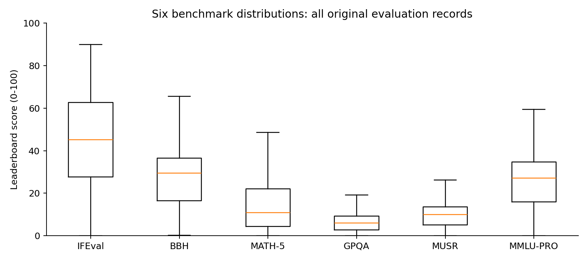

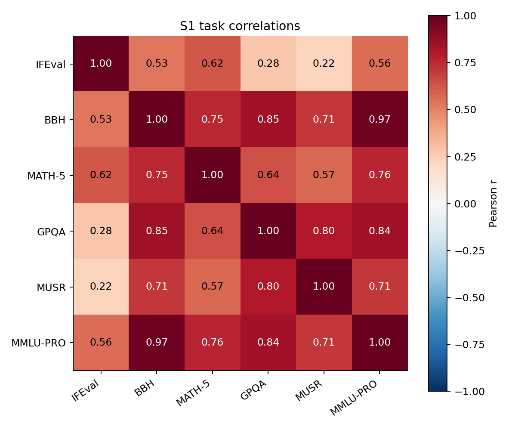

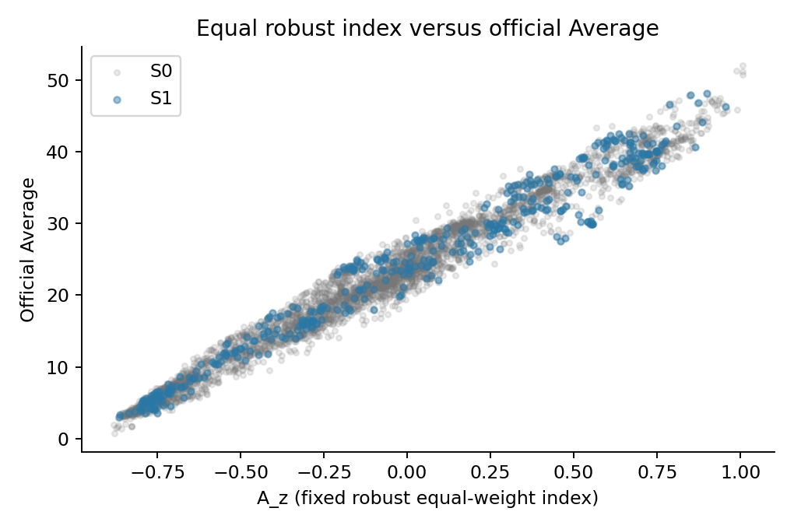

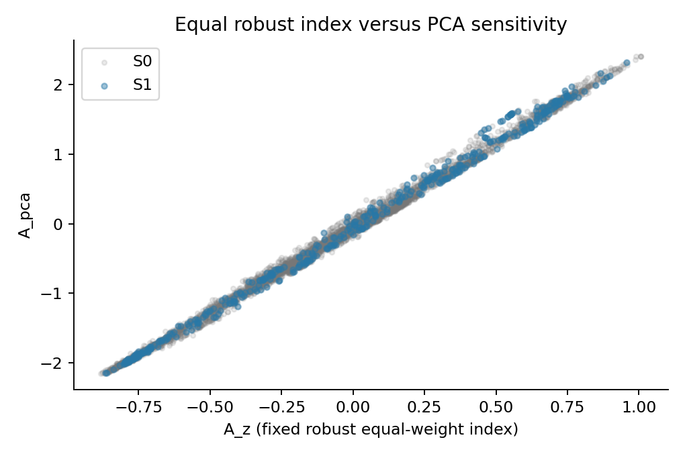

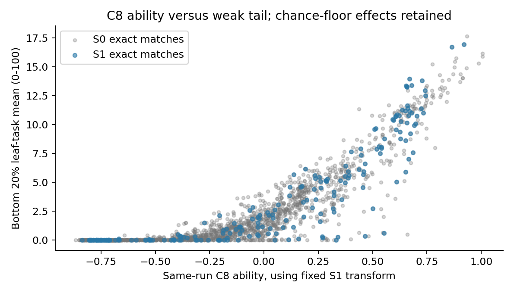

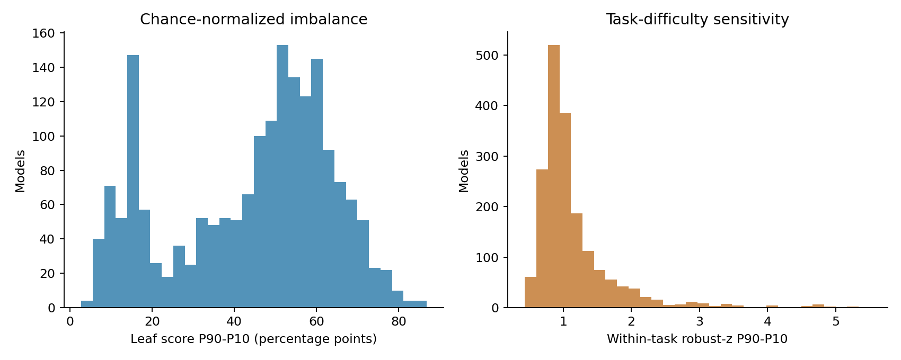

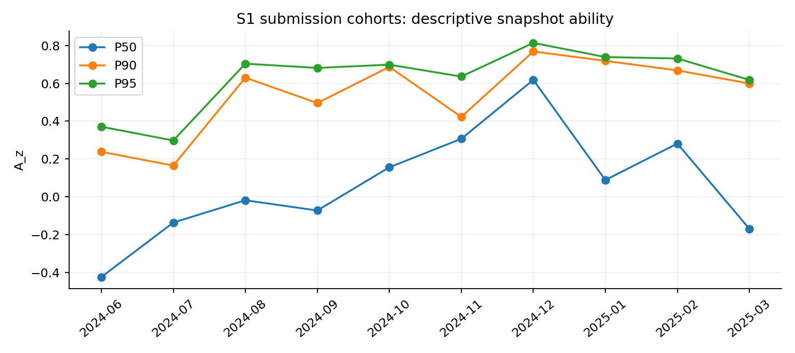

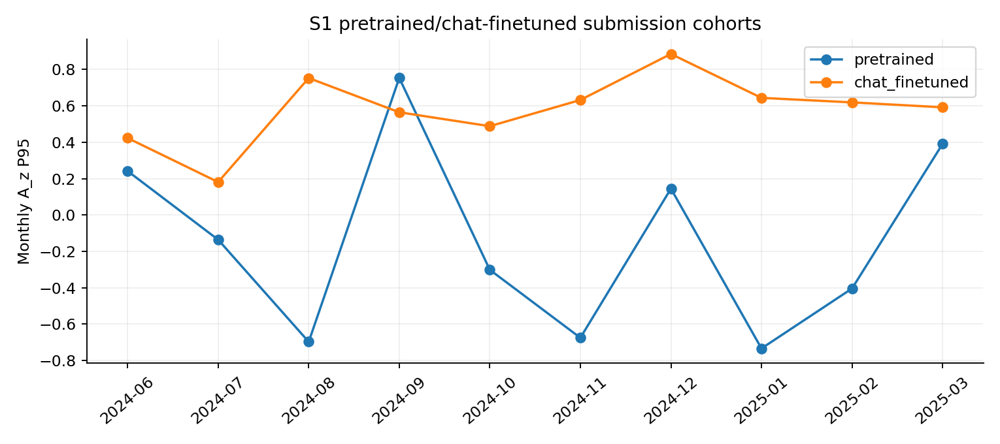

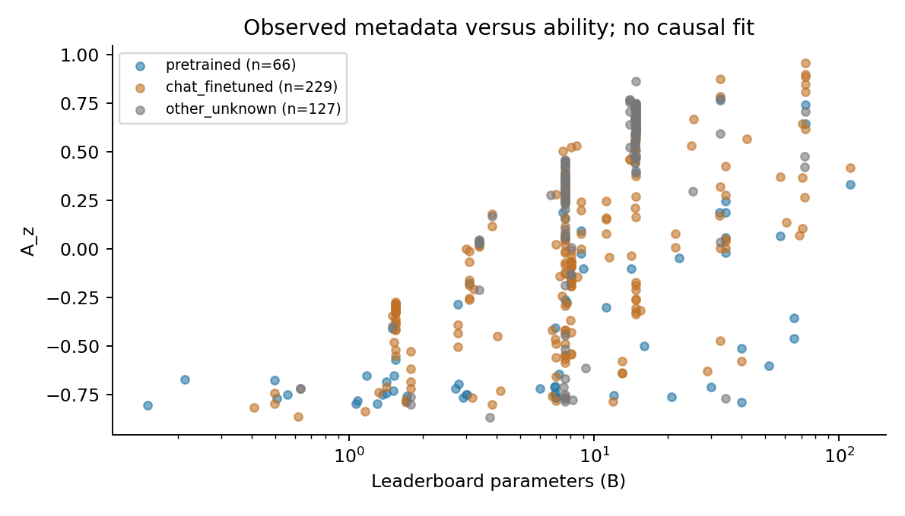

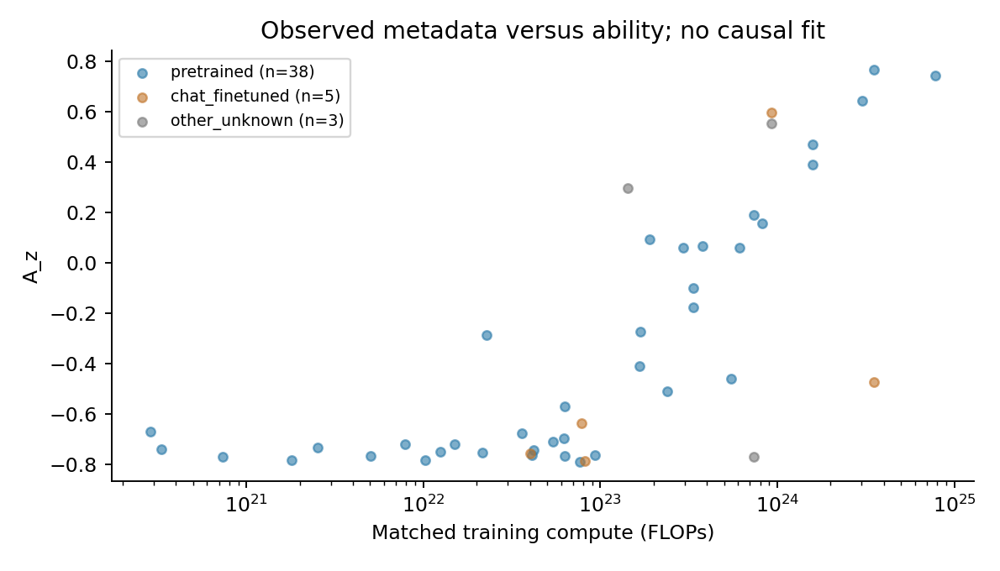

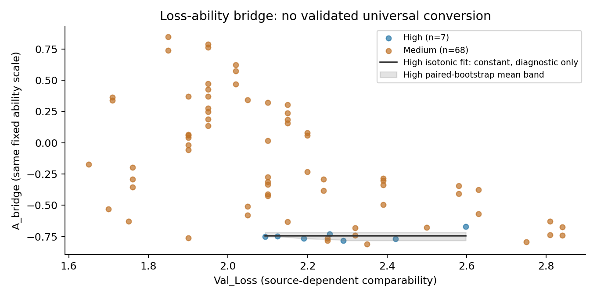

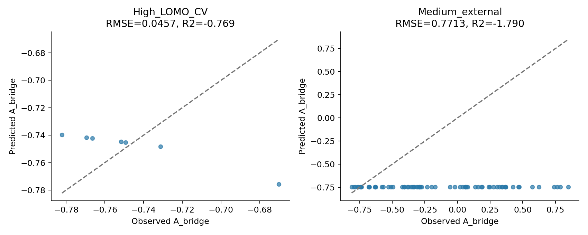
