# 问题四 PHASE 2：规模扩张与非规模技术进步贡献分解

本阶段读取已人工冻结的PHASE 1能力、模型身份、分类和尺度元数据。A_z和主S1定义不变；没有重拟合前三问、没有重构能力指数、没有Loss数值桥接、没有未来12/24个月预测。

## 1 样本、去重与时间口径

主分析为confirmed open-weight S1中的pretrained：后训练/对齐混杂较少，但仍有模型族、训练数据、架构和评测选择等混杂。chat_finetuned单独作为敏感性，other_unknown不进入主贡献比例。S0仅检查开放权重确认/匹配缺失的样本选择；S2授权证据仍未建立。

| model_type | tier | n | parameter_conflict_n | release_date_n |
| --- | --- | --- | --- | --- |
| pretrained | T0 | 66 | 1 | 66 |
| pretrained | T1 | 38 | 1 | 38 |
| pretrained | T2 | 25 | 1 | 25 |
| pretrained | T3 | 21 | 1 | 21 |
| chat_finetuned | T0 | 229 | 0 | 229 |
| chat_finetuned | T1 | 5 | 0 | 5 |
| chat_finetuned | T2 | 6 | 0 | 6 |
| chat_finetuned | T3 | 2 | 0 | 2 |
| other_unknown | T0 | 127 | 0 | 127 |
| other_unknown | T1 | 3 | 0 | 3 |
| other_unknown | T2 | 1 | 0 | 1 |
| other_unknown | T3 | 1 | 0 | 1 |

每个Model一行，完全沿用冻结的最新Submission Date集合及同日确定性规则。逐模型重新对照C2核验；未择优选最高A。dedup_audit.csv保留所有选中与旧记录行号，同日重复评测采用PHASE 1已冻结的逐Benchmark中位数。

主时间起点2024-06-08、末日2025-03-06；t_month=实际经过天数/30.4375，连续月数，不用整数年份。Release以受限样本的实际发布日计算，另作敏感性。

按用户本阶段T0–T3定义统计，T3为21，并非预设20。保留1条PHASE 1参数冲突记录；主结果不自动删除，另列无冲突20模型敏感性。缺N/D/compute不插值，compute只使用公开C4字段，不由6ND或前三问反算。

## 2 模型、估计及线性时间选择

$M1:A=a+\beta_N\ln N+\tau t+\epsilon$；$M2\text{-}C:A=a+\beta_C\ln C_{train}+\tau_Ct+\epsilon$；$M3:A=a+\beta_N\ln N+\beta_D\ln D+\tau_{ND}t+\epsilon$。M2/M3在同一T3样本上拟合，不同时加入lnC、lnN和lnD。

时间项统一称“控制规模后的非规模技术进步代理项”，不是可识别的因果技术效应。lnN是参数规模，lnC是整体训练规模代理，lnN+lnD是结构敏感性；R1/R2/R3不能合并成一个贡献数字。尤其M1只控制参数量，时间项仍可能吸收未观察的训练数据量/训练算力扩张，不能称为排除全部规模因素后的纯技术效应。

| model | term | n | coef | SE | CI_low | CI_high | p_value |
| --- | --- | --- | --- | --- | --- | --- | --- |
| M1_linear | intercept | 66 | -0.789943 | 0.058336 | -0.906518 | -0.673368 | 2.55186e-20 |
| M1_linear | lnN | 66 | 0.182341 | 0.0308941 | 0.120604 | 0.244078 | 1.55607e-07 |
| M1_linear | t_month | 66 | 0.0426116 | 0.018817 | 0.00500881 | 0.0802144 | 0.0269919 |
| M2_C | intercept | 21 | -8.63085 | 2.16683 | -13.1832 | -4.0785 | 0.000871918 |
| M2_C | lnC | 21 | 0.156425 | 0.0412598 | 0.0697413 | 0.243109 | 0.00133731 |
| M2_C | t_month | 21 | 0.0358582 | 0.0249677 | -0.0165969 | 0.0883133 | 0.168102 |
| M3_ND | intercept | 21 | -7.3219 | 1.85132 | -11.2278 | -3.41595 | 0.00102229 |
| M3_ND | lnN | 21 | 0.0778226 | 0.0669606 | -0.0634518 | 0.219097 | 0.261205 |
| M3_ND | lnD | 21 | 0.243112 | 0.0711745 | 0.0929469 | 0.393277 | 0.0032938 |
| M3_ND | t_month | 21 | 0.0257221 | 0.0241305 | -0.0251887 | 0.0766329 | 0.301348 |

HC3主诊断使用t参考分布；OLS常规SE/CI/p亦完整保存。HuberT为稳健敏感性。实现依据[statsmodels稳健协方差文档](https://www.statsmodels.org/stable/generated/statsmodels.regression.linear_model.OLSResults.get_robustcov_results.html)及[Huber示例](https://www.statsmodels.org/stable/examples/notebooks/generated/robust_models_0.html)。

| model | evaluation | n | R2 | adjusted_R2 | RMSE | MAE | Pearson | Spearman |
| --- | --- | --- | --- | --- | --- | --- | --- | --- |
| M1_linear | in_sample | 66 | 0.418073 | 0.399599 | 0.336644 | 0.283134 | 0.646586 | 0.66398 |
| M1_linear | LOOCV | 66 | 0.358706 | — | 0.353399 | 0.297219 | 0.600918 | 0.61336 |
| M2_C | in_sample | 21 | 0.669207 | 0.632452 | 0.293736 | 0.255137 | 0.81805 | 0.732705 |
| M2_C | LOOCV | 21 | 0.527751 | — | 0.350965 | 0.300982 | 0.731549 | 0.688312 |
| M3_ND | in_sample | 21 | 0.727574 | 0.679499 | 0.266565 | 0.208839 | 0.85298 | 0.585714 |
| M3_ND | LOOCV | 21 | 0.573077 | — | 0.333698 | 0.26188 | 0.762706 | 0.572727 |

| model | evaluation | n | RMSE | AICc | BIC | unidentifiable_folds |
| --- | --- | --- | --- | --- | --- | --- |
| M1_linear | in_sample | 66 | 0.336644 | 49.9748 | 56.1566 | — |
| M1_linear | LOOCV | 66 | 0.353399 | — | — | 0 |
| M1_quadratic | in_sample | 66 | 0.333839 | 51.1391 | 59.242 | — |
| M1_quadratic | LOOCV | 66 | 0.361635 | — | — | 0 |
| M1_month_FE | in_sample | 66 | 0.31487 | 61.65 | 80.8474 | — |
| M1_month_FE | LOOCV | 62 | — | — | — | 4 |

quadratic lacks joint LOOCV/AICc/BIC improvement; month FE may have unidentifiable singleton-month folds。月固定效应有4个单样本月份，留出该模型即无法估计该月效应；没有把最小范数外推或局部62折成绩冒充完整LOOCV。HC3因杠杆值1而退化，SE/CI/p均明确记NaN及UNIDENTIFIABLE_LEVERAGE_ONE，不能使用库产生的inf标准误及p=1进行推断。

## 3 稳健性、共线性与影响点

| model | condition_number_raw | condition_number_standardized | Koenker_BP_p | Jarque_Bera | JB_p | Cook_exceed_count | max_Cook_Model |
| --- | --- | --- | --- | --- | --- | --- | --- |
| M1_linear | 5.98885 | 1.09928 | 0.000118076 | 1.4745 | 0.478427 | 5 | Qwen/Qwen2.5-32B |
| M2_C | 1028.03 | 1.08585 | 0.531436 | 1.72147 | 0.422851 | 2 | EleutherAI/pythia-160m |
| M3_ND | 593.418 | 1.79825 | 0.247902 | 0.454086 | 0.796887 | 2 | Qwen/Qwen2-1.5B |

| model | term | VIF |
| --- | --- | --- |
| M1_linear | lnN | 1.00899 |
| M1_linear | t_month | 1.00899 |
| M2_C | lnC | 1.0068 |
| M2_C | t_month | 1.0068 |
| M3_ND | lnN | 1.3856 |
| M3_ND | lnD | 1.36656 |
| M3_ND | t_month | 1.02119 |

报告原始与中心化尺度一致后的condition number，避免把lnD/lnC单位导致的大截距误判为强共线性。M3本次VIF未达到配置警戒值，但小样本、bootstrap和留一系数符号不稳仍会限制贡献解释。Cook>4/n仅诊断；主模型保留全部记录，删除最高1/2条只是规定敏感性。

| Model | Cooks_distance | leverage | residual |
| --- | --- | --- | --- |
| Qwen/Qwen2.5-32B | 0.0801796 | 0.043678 | 0.773282 |
| Qwen/Qwen2.5-72B | 0.0778535 | 0.0661163 | 0.604799 |
| ai21labs/Jamba-v0.1 | 0.0766604 | 0.0542966 | -0.670637 |
| braindao/Qwen2.5-14B | 0.0680991 | 0.172536 | 0.310251 |
| Qwen/Qwen2-72B | 0.0672058 | 0.0545308 | 0.626417 |

| model | inference | n | coef | CI_low | CI_high | p_value |
| --- | --- | --- | --- | --- | --- | --- |
| M1_linear | HC3 | 66 | 0.0426116 | 0.00500881 | 0.0802144 | 0.0269919 |
| M1_Huber | Huber_H3 | 66 | 0.0410473 | 0.0056179 | 0.0764768 | 0.0231623 |
| M1_drop_Cook_top1 | HC3 | 65 | 0.0380676 | 0.000841699 | 0.0752935 | 0.04519 |
| M1_drop_Cook_top2 | HC3 | 64 | 0.0337192 | -0.00380374 | 0.0712422 | 0.0772993 |
| M1_S0_sensitivity | HC3 | 321 | 0.00230373 | -0.00710443 | 0.0117119 | 0.630308 |
| M1_chat | HC3 | 229 | 0.0295923 | 0.0124179 | 0.0467667 | 0.000809697 |
| M1_organization_known | HC3 | 65 | 0.0424132 | 0.00469519 | 0.0801313 | 0.0281552 |
| M1_organization_known | organization_clustered | 65 | 0.0424132 | -0.00780871 | 0.0926352 | 0.0938052 |
| M1_drop_largest_organization | HC3 | 49 | 0.0153967 | -0.0204759 | 0.0512694 | 0.392101 |

| model | term | valid_draws | CI_low | CI_high | positive_fraction |
| --- | --- | --- | --- | --- | --- |
| M1_linear | intercept | 5000 | -0.911036 | -0.695047 | 0 |
| M1_linear | lnN | 5000 | 0.125883 | 0.240781 | 1 |
| M1_linear | t_month | 5000 | 0.010613 | 0.0800984 | 0.9956 |
| M2_C | intercept | 5000 | -12.1916 | -3.4844 | 0 |
| M2_C | lnC | 5000 | 0.0558913 | 0.223109 | 0.9994 |
| M2_C | t_month | 5000 | -0.0112474 | 0.17834 | 0.9354 |
| M3_ND | intercept | 5000 | -10.3766 | -3.05255 | 0.0012 |
| M3_ND | lnN | 5000 | -0.0181831 | 0.189617 | 0.9234 |
| M3_ND | lnD | 5000 | 0.0896301 | 0.360879 | 0.9976 |
| M3_ND | t_month | 5000 | -0.0184636 | 0.150997 | 0.875 |

| model | term | folds | positive_fraction | negative_fraction | min_coef | max_coef |
| --- | --- | --- | --- | --- | --- | --- |
| M1_linear | intercept | 66 | 0 | 1 | -0.820307 | -0.773328 |
| M1_linear | lnN | 66 | 1 | 0 | 0.171514 | 0.192763 |
| M1_linear | t_month | 66 | 1 | 0 | 0.034893 | 0.0497289 |
| M2_C | intercept | 21 | 0 | 1 | -10.0694 | -7.72119 |
| M2_C | lnC | 21 | 1 | 0 | 0.138748 | 0.18304 |
| M2_C | t_month | 21 | 1 | 0 | 0.0240698 | 0.0476273 |
| M3_ND | intercept | 21 | 0 | 1 | -8.78778 | -6.59904 |
| M3_ND | lnN | 21 | 1 | 0 | 0.0304249 | 0.113637 |
| M3_ND | lnD | 21 | 1 | 0 | 0.216685 | 0.301228 |
| M3_ND | t_month | 21 | 1 | 0 | 0.0130386 | 0.0345982 |

组织按附件实际完整组织/合作团体字符串聚类，不按模型名猜实验室；多组织合作团体可能共享成员，聚类独立性仍有限。没有加入大量组织虚拟变量。S1主样本65条具有组织记录，另1条未知保留在主拟合。

## 4 Early/Late状态与Shapley贡献

主窗口为主Submission日历区间前1/3与后1/3；敏感性为前25%与后25%。中段参与拟合；N状态取median lnN，D/C按要求先取原始token/FLOP的中位数再取对数，t取中位数，不按模型个数三等分。原始N/D/C中位数也保存在端点审计。此为典型状态预测变化，不等于观察到的中位能力变化或最大能力前沿变化。

$\Delta_{scale}=\tfrac12[f(S_1,t_0)-f(S_0,t_0)+f(S_1,t_1)-f(S_0,t_1)]$；$\Delta_{tech}=\tfrac12[f(S_0,t_1)-f(S_0,t_0)+f(S_1,t_1)-f(S_1,t_0)]$。所有可识别计算验证$|\Delta_{pred}-\Delta_{scale}-\Delta_{tech}|<10^{-10}$。加性线性模型没有交互，Shapley退化为相应系数乘状态差；公式仍完整执行。

| series | n | early_n | late_n | Delta_scale | Delta_tech | Delta_pred | share_scale | share_tech | absolute_share_scale | absolute_share_tech | cancellation_effect |
| --- | --- | --- | --- | --- | --- | --- | --- | --- | --- | --- | --- |
| R1 | 66 | 48 | 6 | -0.140117 | 0.321293 | 0.181176 | — | — | 0.303672 | 0.696328 | True |
| R2 | 21 | 17 | 2 | -0.460504 | 0.270372 | -0.190131 | — | — | 0.630071 | 0.369929 | True |
| R3 | 21 | 17 | 2 | -0.21308 | 0.193946 | -0.0191349 | — | — | 0.523506 | 0.476494 | True |

| series | early_n | late_n | Delta_scale | Delta_tech | Delta_pred | share_scale | absolute_share_scale |
| --- | --- | --- | --- | --- | --- | --- | --- |
| R1 | 47 | 4 | -0.140597 | 0.336693 | 0.196096 | — | 0.294574 |
| R2 | 16 | 2 | -0.483523 | 0.270372 | -0.213151 | — | 0.641366 |
| R3 | 16 | 2 | -0.341277 | 0.193946 | -0.147331 | — | 0.637635 |

只有预测增长>0且两项均非负时share_scale/share_tech才是普通0–100%增长比例。若一项负值，普通share留NaN，保留signed contribution、signed_ratio和absolute share，并标明抵消效应。signed_ratio的区间可以越出0/1；它不是合法非负贡献百分比。没有截断负贡献。

T3晚期仅2个模型，都是2023年发布、2025年提交的Pythia。数据上“晚提交”不等于“新技术”；两个端点构成对时间口径和典型状态尤其敏感。R2/R3均为restricted-sample evidence，不是全体开源模型的比例。

## 5 模型级bootstrap及贡献区间

每套方案执行5000次模型级有放回抽样，每次重新拟合、重新计算抽中模型的端点中位数并重新Shapley；固定原始日历边界。主R1/R2/R3、chat、S0和三套Release敏感性均执行，固定随机种子。

| series | quantity | draws | valid_decomposition_draws | valid_quantity_draws | CI_low | CI_high | ratio_CI_outside_zero_one |
| --- | --- | --- | --- | --- | --- | --- | --- |
| R1 | Delta_scale | 5000 | 4989 | 4989 | -0.382001 | 0.145718 | False |
| R1 | Delta_tech | 5000 | 4989 | 4989 | 0.0785658 | 0.598755 | False |
| R1 | signed_ratio_scale | 5000 | 4989 | 4989 | -17.1763 | 17.9393 | True |
| R1 | signed_ratio_tech | 5000 | 4989 | 4989 | -16.9393 | 18.1763 | True |
| R1 | absolute_share_scale | 5000 | 4989 | 4989 | 0.00229135 | 0.756068 | False |
| R1 | absolute_share_tech | 5000 | 4989 | 4989 | 0.243932 | 0.997709 | False |
| R2 | Delta_scale | 5000 | 4372 | 4372 | -0.746032 | -0.145039 | False |
| R2 | Delta_tech | 5000 | 4372 | 4372 | -0.0503115 | 0.572789 | False |
| R2 | signed_ratio_scale | 5000 | 4372 | 4372 | -10.9115 | 19.1584 | True |
| R2 | signed_ratio_tech | 5000 | 4372 | 4372 | -18.1584 | 11.9115 | True |
| R2 | absolute_share_scale | 5000 | 4372 | 4372 | 0.41434 | 0.92953 | False |
| R2 | absolute_share_tech | 5000 | 4372 | 4372 | 0.0704696 | 0.58566 | False |
| R3 | Delta_scale | 5000 | 4349 | 4349 | -0.620582 | 0.000641623 | False |
| R3 | Delta_tech | 5000 | 4349 | 4349 | -0.109255 | 0.487955 | False |
| R3 | signed_ratio_scale | 5000 | 4349 | 4349 | -19.1268 | 19.6791 | True |
| R3 | signed_ratio_tech | 5000 | 4349 | 4349 | -18.6791 | 20.1268 | True |
| R3 | absolute_share_scale | 5000 | 4349 | 4349 | 0.118105 | 0.935095 | False |
| R3 | absolute_share_tech | 5000 | 4349 | 4349 | 0.0649053 | 0.881895 | False |

| model | time_axis | window_fraction | status | draws |
| --- | --- | --- | --- | --- |
| M1_linear | submission | 0.25 | EMPTY_ENDPOINT_WINDOW | 90 |
| M1_linear | submission | 0.25 | OK | 4910 |
| M1_linear | submission | 0.333333 | EMPTY_ENDPOINT_WINDOW | 11 |
| M1_linear | submission | 0.333333 | OK | 4989 |
| M2_C | submission | 0.25 | EMPTY_ENDPOINT_WINDOW | 628 |
| M2_C | submission | 0.25 | OK | 4372 |
| M2_C | submission | 0.333333 | EMPTY_ENDPOINT_WINDOW | 628 |
| M2_C | submission | 0.333333 | OK | 4372 |
| M3_ND | submission | 0.25 | EMPTY_ENDPOINT_WINDOW | 651 |
| M3_ND | submission | 0.25 | OK | 4349 |
| M3_ND | submission | 0.333333 | EMPTY_ENDPOINT_WINDOW | 651 |
| M3_ND | submission | 0.333333 | OK | 4349 |

当重抽样导致窗口为空或设计矩阵降秩，保留该次抽样及状态，不补模型、不悄悄重抽直到成功。贡献CI以可识别draw计算，明确是条件区间；普通非负share的CI还额外条件于非负增长。完整signed_ratio区间用于暴露抵消及分母接近零的不稳定性。模型级bootstrap不能处理族内依赖，组织敏感性另行保留。

## 6 模型类型、S0与时间口径敏感性

| model | n | beta_N | tau | sample | meaning |
| --- | --- | --- | --- | --- | --- |
| M1_linear | 66 | 0.182341 | 0.0426116 | S1_pretrained_T0 | descriptive conditional time trend; not a causal post-training effect |
| M1_chat | 229 | 0.272506 | 0.0295923 | S1_chat_finetuned_T0 | descriptive conditional time trend; not a causal post-training effect |
| M1_S0_sensitivity | 321 | 0.117336 | 0.00230373 | S0_pretrained_T0 | descriptive conditional time trend; not a causal post-training effect |
| M1_same_T3 | 21 | 0.193356 | 0.0368545 | S1_pretrained_T3 | descriptive conditional time trend; not a causal post-training effect |
| M1_drop_largest_organization | 49 | 0.110846 | 0.0153967 | S1_pretrained_T0 | descriptive conditional time trend; not a causal post-training effect |

pretrained与chat的tau差只描述分组趋势强弱，不等于某种对齐方法的因果效应。S0扩大样本改变tau，说明confirmed-open匹配/元数据选择不可忽略。

| series | window_fraction | submission_n | release_n | submission_Delta_scale | release_Delta_scale | submission_Delta_tech | release_Delta_tech | submission_signed_ratio_scale | release_signed_ratio_scale | submission_signed_ratio_tech | release_signed_ratio_tech | submission_share_scale | release_share_scale | submission_share_tech | release_share_tech | submission_absolute_share_scale | release_absolute_share_scale | submission_absolute_share_tech | release_absolute_share_tech | absolute_share_difference | contribution_sign_reversal | time_axis_sensitive | definition |
| --- | --- | --- | --- | --- | --- | --- | --- | --- | --- | --- | --- | --- | --- | --- | --- | --- | --- | --- | --- | --- | --- | --- | --- |
| R1 | 0.333333 | 46 | 46 | -0.298465 | 0.169952 | 0.446048 | 0.778466 | -2.02234 | 0.179196 | 3.02234 | 0.820804 | — | 0.179196 | — | 0.820804 | 0.400886 | 0.179196 | 0.599114 | 0.820804 | 0.22169 | True | True | same models; submission windows on main calendar; release windows on observed release range; chronological orders differ |
| R1 | 0.25 | 46 | 46 | -0.298465 | 0.230493 | 0.446048 | 0.778466 | -2.02234 | 0.228447 | 3.02234 | 0.771553 | — | 0.228447 | — | 0.771553 | 0.400886 | 0.228447 | 0.599114 | 0.771553 | 0.172439 | True | True | same models; submission windows on main calendar; release windows on observed release range; chronological orders differ |
| R2 | 0.333333 | 21 | 21 | -0.460504 | 0.391182 | 0.270372 | 0.588173 | 2.42203 | 0.399428 | -1.42203 | 0.600572 | — | 0.399428 | — | 0.600572 | 0.630071 | 0.399428 | 0.369929 | 0.600572 | 0.230643 | True | True | same models; submission windows on main calendar; release windows on observed release range; chronological orders differ |
| R2 | 0.25 | 21 | 21 | -0.483523 | 0.599596 | 0.270372 | 0.588173 | 2.26846 | 0.504809 | -1.26846 | 0.495191 | — | 0.504809 | — | 0.495191 | 0.641366 | 0.504809 | 0.358634 | 0.495191 | 0.136557 | True | True | same models; submission windows on main calendar; release windows on observed release range; chronological orders differ |
| R3 | 0.333333 | 21 | 21 | -0.21308 | 0.566748 | 0.193946 | 0.428827 | 11.1357 | 0.569267 | -10.1357 | 0.430733 | — | 0.569267 | — | 0.430733 | 0.523506 | 0.569267 | 0.476494 | 0.430733 | 0.0457612 | True | True | same models; submission windows on main calendar; release windows on observed release range; chronological orders differ |
| R3 | 0.25 | 21 | 21 | -0.341277 | 0.629219 | 0.193946 | 0.428827 | 2.31639 | 0.594699 | -1.31639 | 0.405301 | — | 0.594699 | — | 0.405301 | 0.637635 | 0.594699 | 0.362365 | 0.405301 | 0.0429366 | True | True | same models; submission windows on main calendar; release windows on observed release range; chronological orders differ |

time_axis_sensitive当贡献符号反转，或absolute scale share差>10%时标记；该阈值是透明诊断约定，不是统计显著性检验。Release只纳入PHASE 1接受的C4身份且有发布日期的模型；Submission对照使用完全相同的模型，模型数及端点变化完整列出。实际时间范围和排序改变，因而窗口模型组成也改变。

## 7 技术残差、月度前沿、C8及架构线索

$TechResidual=A-[\hat a+\hat\beta_N\ln N]$。按月保存P50/P75/P90/P95并做时间描述；辅助残差~time回归使用生成响应，标准误不作为独立证据，主要推断仍来自联合M1的HC3/bootstrap。

| month | n | P90_A | P95_A | top3_mean_A | top3_actual_n | median_lnN | top3_median_lnN |
| --- | --- | --- | --- | --- | --- | --- | --- |
| 2024-06 | 43 | 0.169148 | 0.241486 | 0.407469 | 3 | 1.97046 | 4.28642 |
| 2024-07 | 2 | -0.170086 | -0.136004 | -0.442739 | 2 | 1.36686 | 1.36686 |
| 2024-08 | 3 | -0.699703 | -0.697309 | -0.738962 | 3 | 1.02783 | 1.02783 |
| 2024-09 | 10 | 0.74296 | 0.753373 | 0.657352 | 3 | 2.36142 | 3.48933 |
| 2024-10 | 1 | -0.301434 | -0.301434 | -0.301434 | 1 | 2.41314 | 2.41314 |
| 2024-11 | 1 | -0.675249 | -0.675249 | -0.675249 | 1 | -0.70522 | -0.70522 |
| 2024-12 | 2 | 0.102657 | 0.144656 | -0.233338 | 2 | 1.21485 | 1.21485 |
| 2025-01 | 2 | -0.736371 | -0.73383 | -0.7567 | 2 | 0.245725 | 0.245725 |
| 2025-02 | 1 | -0.404263 | -0.404263 | -0.404263 | 1 | 1.93427 | 1.93427 |
| 2025-03 | 1 | 0.390672 | 0.390672 | 0.390672 | 1 | 2.6926 | 2.6926 |

不足3模型的月份top3_mean只取实际可用模型并明确实际n。月度P90/P95明显起伏，未呈稳定单调提升，不能将个体回归的正时间项直接等同于前沿持续改善。多个月份n=1，无法从10个队列前沿点建立稳定因果贡献或长期预测。当前快照可能回溯重评，Submission cohort不是已证实的当时能力前沿。

| model | analysis | variable | n | Pearson | Pearson_p_BH_q | Spearman | Spearman_p_BH_q |
| --- | --- | --- | --- | --- | --- | --- | --- |
| M1_linear | C8 | C8_capability_imbalance | 35 | 0.570929 | 0.000455266 | 0.441457 | 0.00793638 |
| M1_linear | C8 | C8_bottom20_task_score | 35 | 0.654915 | 7.86308e-05 | 0.725846 | 3.21747e-06 |
| M1_linear | C8 | difficulty_adjusted_imbalance | 35 | 0.506559 | 0.00190198 | 0.653501 | 4.15496e-05 |
| M1_linear | C8 | difficulty_adjusted_bottom20 | 35 | 0.619053 | 0.000147094 | 0.491877 | 0.00358668 |
| M1_linear | architecture | context_length | 19 | 0.727399 | 0.00166681 | 0.7144 | 0.00235768 |
| M1_linear | architecture | n_layers | 19 | 0.284572 | 0.316898 | 0.119015 | 0.880141 |
| M1_linear | architecture | d_model | 19 | 0.0569972 | 0.81672 | 0.0272769 | 0.911739 |
| M1_linear | architecture | n_heads | 19 | -0.316041 | 0.316898 | -0.107921 | 0.880141 |
| M1_linear | C8_same_run_auxiliary | C8_capability_imbalance | 35 | 0.565725 | 0.00079502 | 0.42605 | 0.0107128 |
| M1_linear | C8_same_run_auxiliary | difficulty_adjusted_imbalance | 35 | 0.499533 | 0.00224942 | 0.638375 | 7.37702e-05 |
| M1_chat | C8 | C8_capability_imbalance | 97 | 0.698066 | 7.65926e-15 | 0.674925 | 1.37581e-13 |
| M1_chat | C8 | C8_bottom20_task_score | 97 | 0.54514 | 1.03633e-08 | 0.599313 | 1.17936e-10 |
| M1_chat | C8 | difficulty_adjusted_imbalance | 97 | 0.333537 | 0.000842268 | 0.321594 | 0.00131791 |
| M1_chat | C8 | difficulty_adjusted_bottom20 | 97 | 0.688214 | 1.35327e-14 | 0.625942 | 1.41845e-11 |
| M1_chat | architecture | context_length | 0 | — | — | — | — |
| M1_chat | architecture | n_layers | 0 | — | — | — | — |
| M1_chat | architecture | d_model | 0 | — | — | — | — |
| M1_chat | architecture | n_heads | 0 | — | — | — | — |
| M1_chat | C8_same_run_auxiliary | C8_capability_imbalance | 97 | 0.62129 | 2.24264e-11 | 0.605968 | 9.62407e-11 |
| M1_chat | C8_same_run_auxiliary | difficulty_adjusted_imbalance | 97 | 0.296446 | 0.00319446 | 0.283986 | 0.00481789 |

原始C8偏科同时受任务难度、任务数量及测评版本影响，补充difficulty-adjusted与same-run对照。相关弱也不能证明偏科没有作用；若相关强，技术残差不能排除任务结构影响。C7只用单变量架构相关；未建立多变量架构回归，BH q只作探索性多重检验提示。

## 8 结论、负面桥接与停止点

M1的控制参数时间项tau=0.0426116/月，HC3 p=0.0269919，bootstrap 95%区间[0.010613,0.0800984]。但组织聚类p=0.0938052，去除最大组织p=0.392101，S0敏感性p=0.630308。因此能支持特定S1样本内的条件时间关联；证据具有样本选择和组织依赖，不能宣称普遍稳定或严格因果的非规模技术进步。

C6桥接负面证据单独保存bridge_negative_evidence.md：High仅7条同族，CV R²均负，单调退化常数，Medium外验失败。固定bridge_valid_for_conversion=False，前三问Loss不转换为A_z、不参与贡献比例。

PHASE 3仅具备在人工确认后开展受限、描述性Benchmark前沿敏感性分析的输入准备；未建立可靠12/24个月外推条件。需要明确历史快照/真实评测时点、稀疏月份、族/组织依赖和可比数据支持。到此停止，不拟合最终前沿、不预测未来、不做因果结论。

## 附录：复现与证据文件

`python -X utf8 -B scripts/21_build_evolution_contribution.py --stage all`；支持samples/models/bootstrap/report分阶段。`python -X utf8 -B scripts/21_verify_evolution_contribution.py`独立复核。新配置、代码和输出均独立，冻结文件按SHA256核验。

[analysis_model_table.csv](../evolution/phase2/analysis_model_table.csv)

[bootstrap_status_audit.csv](../evolution/phase2/bootstrap_status_audit.csv)

[coefficient_bootstrap.csv](../evolution/phase2/coefficient_bootstrap.csv)

[coefficient_bootstrap_summary.csv](../evolution/phase2/coefficient_bootstrap_summary.csv)

[contribution_bootstrap.csv](../evolution/phase2/contribution_bootstrap.csv)

[contribution_bootstrap_summary.csv](../evolution/phase2/contribution_bootstrap_summary.csv)

[contribution_decomposition.csv](../evolution/phase2/contribution_decomposition.csv)

[contribution_sample_tiers.csv](../evolution/phase2/contribution_sample_tiers.csv)

[dedup_audit.csv](../evolution/phase2/dedup_audit.csv)

[figure_manifest.csv](../evolution/phase2/figure_manifest.csv)

[implementation_manifest.csv](../evolution/phase2/implementation_manifest.csv)

[independent_verification.csv](../evolution/phase2/independent_verification.csv)

[influence_diagnostics.csv](../evolution/phase2/influence_diagnostics.csv)

[input_manifest.csv](../evolution/phase2/input_manifest.csv)

[LOOCV_coefficients.csv](../evolution/phase2/LOOCV_coefficients.csv)

[LOOCV_sign_stability.csv](../evolution/phase2/LOOCV_sign_stability.csv)

[model_coefficients.csv](../evolution/phase2/model_coefficients.csv)

[model_performance.csv](../evolution/phase2/model_performance.csv)

[model_predictions.csv](../evolution/phase2/model_predictions.csv)

[model_type_comparison.csv](../evolution/phase2/model_type_comparison.csv)

[monthly_ability_frontier.csv](../evolution/phase2/monthly_ability_frontier.csv)

[monthly_technology_frontier.csv](../evolution/phase2/monthly_technology_frontier.csv)

[non_scale_technology_index.csv](../evolution/phase2/non_scale_technology_index.csv)

[organization_sensitivity.csv](../evolution/phase2/organization_sensitivity.csv)

[regression_diagnostics.csv](../evolution/phase2/regression_diagnostics.csv)

[scale_correlations.csv](../evolution/phase2/scale_correlations.csv)

[technology_auxiliary_correlations.csv](../evolution/phase2/technology_auxiliary_correlations.csv)

[technology_residual_trend.csv](../evolution/phase2/technology_residual_trend.csv)

[time_axis_sensitivity.csv](../evolution/phase2/time_axis_sensitivity.csv)

[VIF_diagnostics.csv](../evolution/phase2/VIF_diagnostics.csv)

[phase3_readiness.json](../evolution/phase2/phase3_readiness.json)

[bridge_negative_evidence.md](../evolution/phase2/bridge_negative_evidence.md)

[verification_summary.json](../evolution/phase2/verification_summary.json)

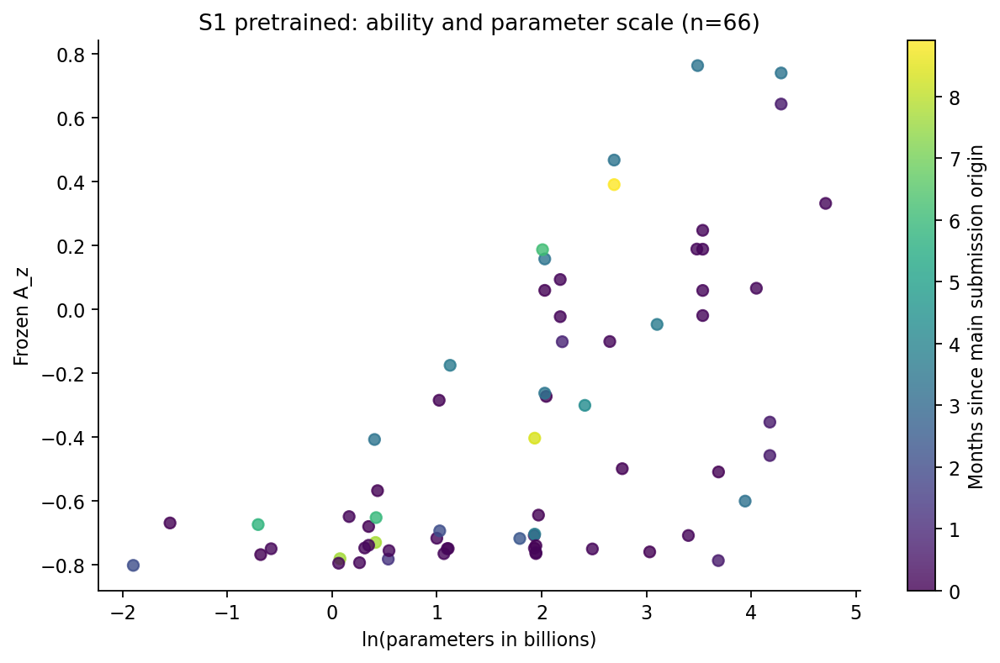

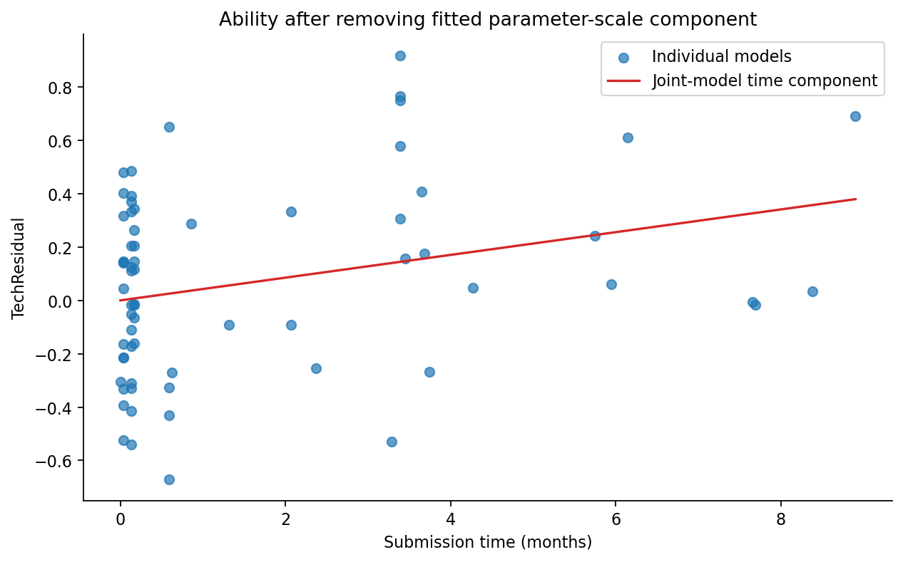

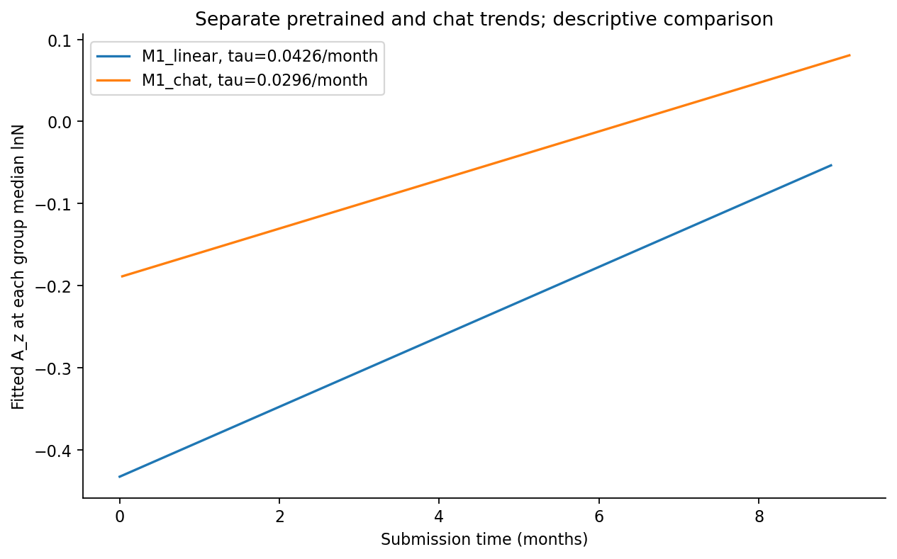

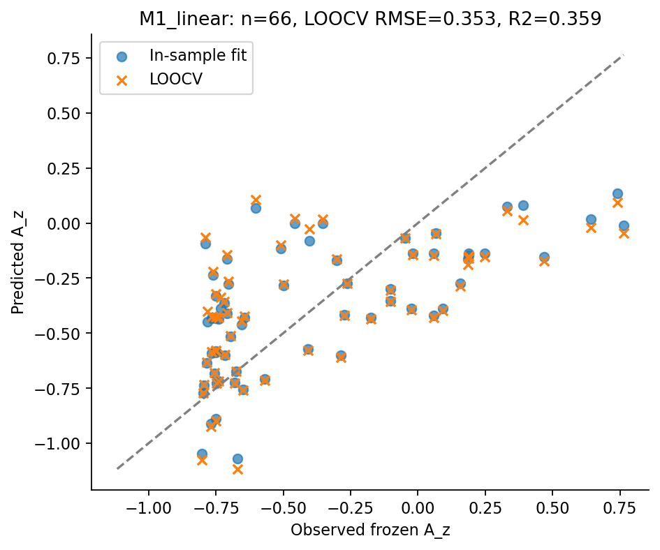

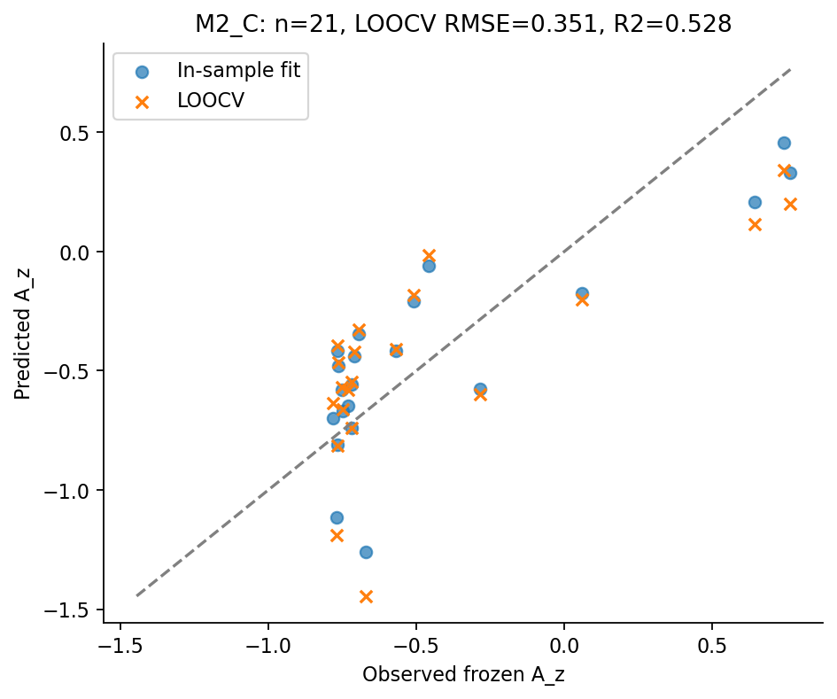

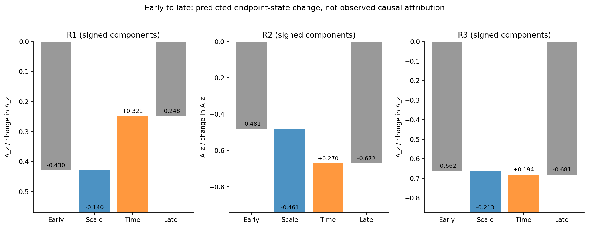

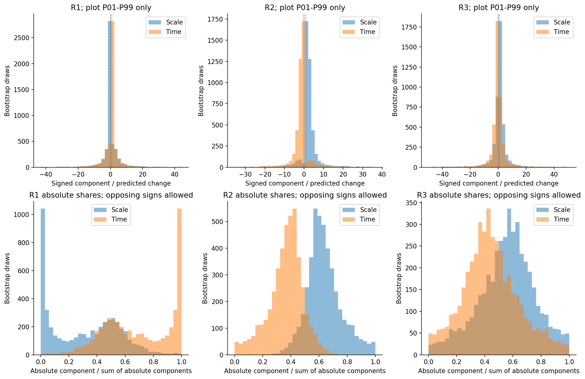

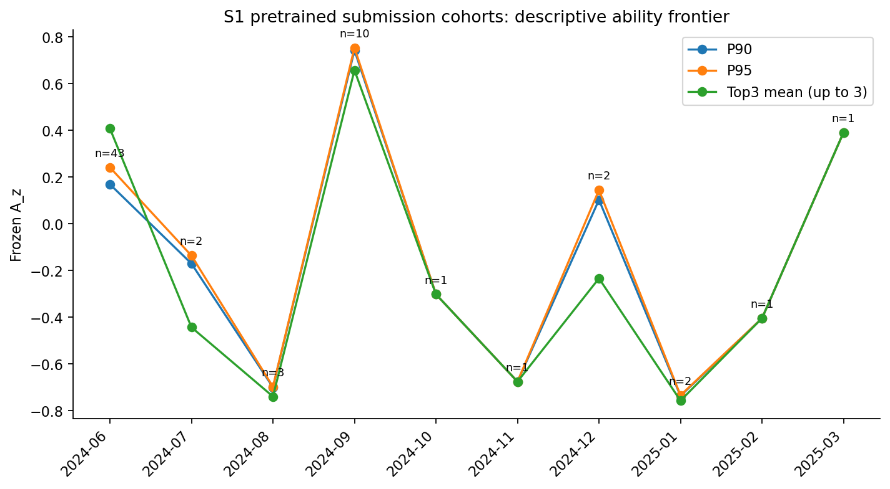

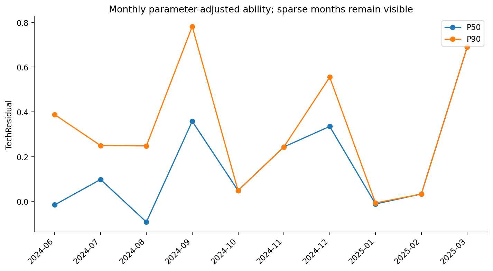

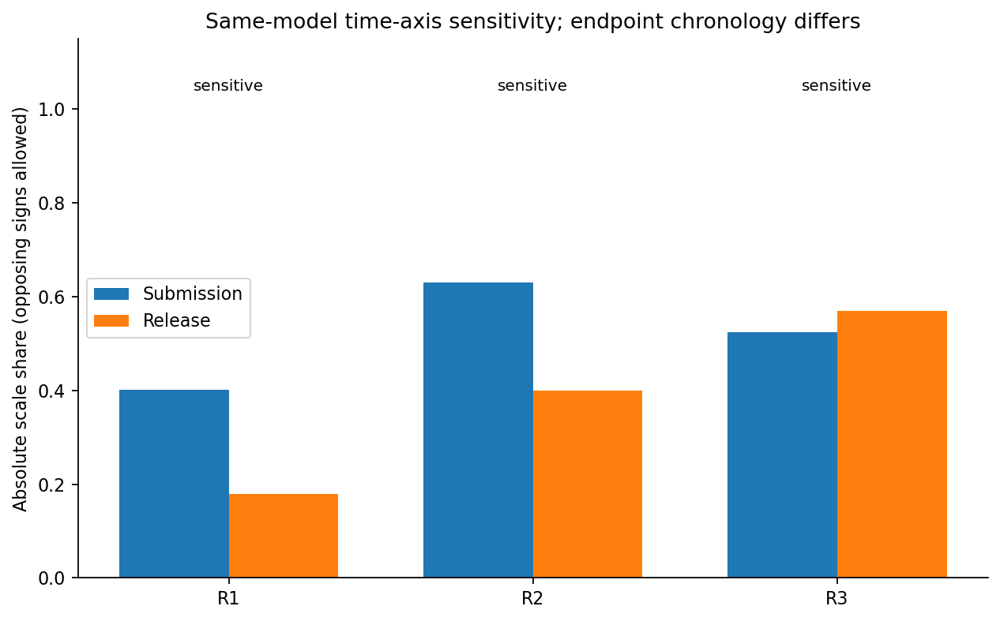

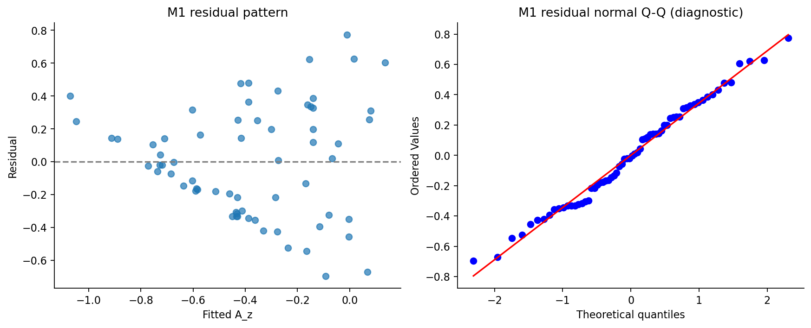

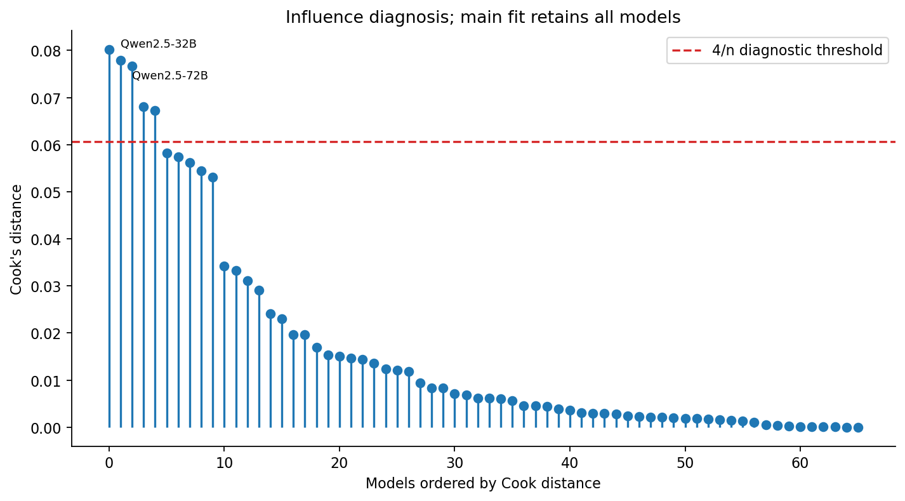